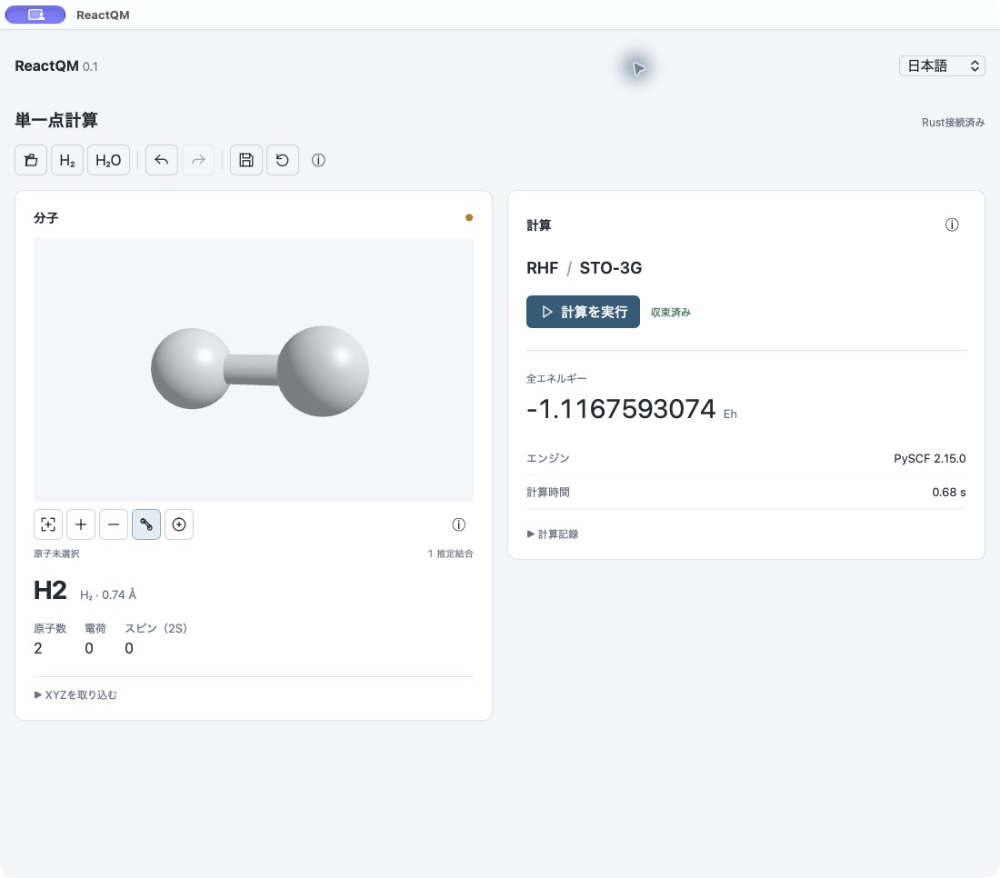

# ReactQM

Tauri 2 / Rustを中核に、React UI、Rust / wgpu描画、独立Python Workerを組み合わせる量子化学アプリです。

現在は **XYZ入力 → wgpuの分子3D表示 → RHF/STO-3Gの実計算 → 結果表示 → 保存／再読込** がmacOSで動作します。構造編集、ドッキング／フローティング、永続ジョブキューは次の段階です。



macOS実画面（2026-11-06）。wgpu / MetalによるH₂の球棒表示と、PySCF RHF/STO-3Gの収束結果です。

English: Native macOS app showing H₂ in 3D and a converged RHF/STO-3G calculation.

简体中文：macOS原生应用，展示H₂的3D球棍模型及已收敛的RHF/STO-3G计算结果。

- [ロードマップ](ROADMAP.md)
- [アーキテクチャ・科学計算の境界](docs/ARCHITECTURE.md)

## 必要環境とセットアップ

macOS / Apple Siliconで検証。Node.js 22.12以上（またはVite 7対応版）、npm、Rust 1.90以上、Xcode、Python 3.12、uvを使用します。

プロジェクト直下で実行します。既存のプロジェクト内キャッシュを利用する場合は、絶対パスを指定してください。

```sh
export CARGO_HOME="$PWD/.cache/cargo"
export UV_CACHE_DIR="$PWD/.cache/uv"
export npm_config_cache="$PWD/.cache/npm"
npm ci
uv sync --project worker --locked --python python3.12
cargo fetch --manifest-path src-tauri/Cargo.toml --locked
npm run tauri dev
```

Python依存は `worker/.venv` に分離します。別の仮想環境が有効でも `uv --active` は付けないでください。

UIのみ確認する場合は `npm run dev` を実行し、`http://127.0.0.1:1420/` を開きます。ブラウザでは計算・取り込み・保存を無効にし、模擬結果は表示しません。

## 最初の計算

1. ツールバーの **H₂** または **H₂O** を押すか、「XYZを取り込む」を展開してXYZを入力し「適用」を押します。ファイルアイコンからXYZファイルを選ぶこともできます。
2. 必要に応じて、取り込み前に電荷・スピン（2S）を設定します。
3. 「計算を実行」を押すと、RustがPython Workerを起動します。SCFの反復数を表示し、実行中は取り消せます。
4. 収束した場合に全エネルギー（hartree / Eh）とエンジン版・計算時間を表示します。計算記録からjob IDと入力SHA-256を確認できます。
5. 保存アイコンで現在の分子と結果を保存します。再読込アイコンで保存時点に戻せます。再起動後も同じ保存先から再読込できます。

分子の取り込みと再読込はUndo／Redoに対応します。異なる分子へ切り替えると古い計算結果は消え、Undoでは元の構造と対応する結果を一緒に復元します。履歴は最大32段で、アプリ終了時に破棄します。

English: Use **H₂** or import a basic XYZ file, then run the RHF/STO-3G calculation. Save stores the molecule and result; Reload restores the saved project. Undo/Redo restores matching molecule/result pairs. The browser preview cannot compute.

简体中文：点击 **H₂** 或导入基本XYZ文件，然后运行RHF/STO-3G计算。保存会保留分子及结果，重新加载可恢复已保存的项目。撤销／重做会同时恢复匹配的结构与结果。浏览器预览不能执行计算。

## 分子の3D表示

macOSではRustが所有するwgpu / Metal描画面をWebViewの予約領域に重ねます。原子配列・メッシュ・描画フレームはJavaScriptへ転送しません。H₂Oサンプルで球棒モデルの奥行きと元素色を確認できます。

- ドラッグ／矢印キー：回転。スクロール／＋・−：拡大縮小。
- 全体表示ボタン／F／Home：カメラを初期位置へ戻す。
- 原子をクリック／Enter／原子選択ボタン：選択。元素・1始まりの番号・Å座標を表示。
- 結合アイコン：距離から推定した結合の表示切替。説明はⓘのhover／focusに表示。

結合は `距離 ≤ 1.2 × 共有結合半径の和` による表示用の推定で、希ガスを除外します。結合次数・価数の検証は行いません。原子の大きさも模式的です。カメラ・選択・結合の表示設定は保存されず、分子変更時はカメラと選択をリセットします。

English: Drag or use arrow keys to rotate, scroll or +/− to zoom, F to fit, click or Enter to select atoms. Bonds are geometry-based visual hints, not validated chemical bond orders. The 3D surface currently requires the macOS Tauri application.

简体中文：拖动或方向键旋转，滚动或+/−缩放，F显示全貌，点击或Enter选择原子。化学键仅为基于几何距离的显示推测，并非经过验证的键级。3D视图目前需要macOS Tauri应用。

## 現在の計算範囲

- 基本XYZの単一フレーム、Å単位、1〜64原子、最大16 KiB。
- 有限座標、原子間距離0.1 Å以上、|座標| ≤ 10,000 Å、|電荷| ≤ 64、電子数とスピンの整合性をRustで検証。
- 文書としては全元素を識別しますが、**実計算はH〜Ne・スピン2S = 0の閉殻系、RHF/STO-3G** に限定しています。
- SCFは最大50反復、収束閾値 `1e-9`、タイムアウト120秒。同時実行は1ジョブです。
- 全エネルギーは核間反発を含み、ZPE・熱補正は含みません。収束は物理的精度や反応予測の正しさを保証する表示ではありません。
- 未収束・異常終了・不正応答・入力との不一致は結果として採用しません。

H₂サンプルは0.74 Å、電荷0、2S = 0。検証値は約 **−1.1167593074 hartree** です。

## 保存先と開発用設定

通常はTauriのアプリデータ領域（このmacOSでは `~/Library/Application Support/dev.reactqm.desktop`）に保存します。

- `workspace.json`：保存操作をした時点の分子と結果。現在は単一の保存スロットです。
- `jobs/<UUID>/input.json`：条件・原子配置・単位・入力hash。
- `jobs/<UUID>/worker.log`：Workerの診断ログ。
- `jobs/<UUID>/result.h5`：座標・エネルギー・勾配と単位属性。
- `jobs/<UUID>/result.json`、`status.json`：成功結果・終了状態。

保存は一時ファイルからの原子的置換です。破損したプロジェクトは読み込まず、現在の状態を維持します。成果物は保存ボタンと独立してjobフォルダに残ります。中断後の復旧・過去ジョブの一覧・SQLite索引はまだ実装していません。

環境変数 `REACTQM_DATA_DIR` で保存先、`REACTQM_PYTHON` でPython実行ファイルを上書きできます。絶対パスを指定してください。UI検証では `/private/tmp/reactqm-ui-qa` を使用しました。

Workerは現在のチェックアウトのソースとvenvを使います。開発用.appは単体配布できる完成品ではありません。

## 検証コマンド

```sh
npm run build
npm run test:rust
npm run test:worker
npm run test:integration
npm run check:worker
npm run check:gpu
npm run test:render
cargo clippy --manifest-path src-tauri/Cargo.toml --all-targets --locked -- -D warnings
```

`test:rust` のプロセステストには `worker/.venv` が必要です。`test:integration` は実際にRustからWorkerを起動し、H₂計算・HDF5生成・結果の保存／再読込まで確認します。`check:gpu` はadapter / deviceの初期化です。`test:render` は実GPUで通常・部分表示・選択・回転／暗色・縦長の5画像を描き、空白画像・元素色・選択色・部分表示の画素一致を検証します。画像は `/private/tmp/reactqm-render/` に出力し、`REACTQM_RENDER_OUTPUT` で出力先を変更できます。画素の読み戻しは検証用Rustプロセス内に限定しています。

2026-11-06、Apple M4 / arm64、Node 26.12.1、Rust 1.99.1、Python 3.12.16で検証しました。

| 確認内容 | 結果 |
|---|---|
| Web型検査・本番ビルド、macOS開発用.app | 成功 |
| Rust unit 12件 + process 2件 | 成功 |
| Python 4件 | 成功 |
| Clippy / all-targets / warnings-as-errors | 成功 |
| Rust→Worker→PySCF→HDF5→保存／再読込 | 成功、H₂ −1.1167593073964257 hartree |
| Worker異常系 | 異常終了・不正／過大応答・別job ID・未収束・無応答／大量出力のtimeout・取消と子プロセス回収を確認 |
| Tauri実画面 | H₂実計算、保存／再読込、不正座標拒否、分子変更、Undo／Redo、取消後の操作復帰を確認 |
| Chromeプレビュー | 日英中、320 / 375 / 1100px、明暗テーマ、keyboard tooltip、横はみ出しなし |
| ブラウザエラー | ページ識別・空白画面・Vite overlay・consoleを確認、エラーなし |
| wgpu描画プローブ | Apple M4 / Metal、4×MSAA、5ケース成功。部分表示が元画像の対応範囲と一致 |
| ネイティブ3D表示 | H₂ / H₂O、回転・ズーム・全体表示・原子選択・結合切替、1100×760 → 1025×1242 → 元サイズ、スクロール、H₂実計算・履歴同期を確認 |
| HiDPI・画面間移動 | ⭕️ [Pending] 1×環境で実機確認。実Retina・異倍率画面間移動・ネイティブ暗色合成は未確認 |

Browser skill/runtimeが利用できないため、ブラウザ検証は一時導入のPlaywrightと既存Chromeを使用しています。ネイティブの操作検証はComputer Useで実施しました。Playwrightは製品依存に含めていません。

## 既知の制限

- 描画はmacOSの単一mainウインドウのみ。ブラウザの代替3D描画、複数描画面、device lossからの自動復旧は未実装です。GPU初期化に失敗した場合はUIにエラーと再試行を表示します。
- SQLite、待機キュー、強制終了／クラッシュ後の復旧、履歴一覧、HDF5内容の再読込は未実装です。
- PySCFのこのwheelではOpenMPが利用できません。CPU並列化性能は未検証です。
- Rustの推移依存 `block 0.1.6` に将来のRust互換性警告があります。現在のビルド・テスト・Clippyは成功しています。
- Metal検証では通常のホスト権限が必要です。実行サンドボックス内ではadapterが見つかりませんでした。
- Windows / Linuxのネイティブ動作、CUDA、署名・公証・別マシン配布は ⭕️ [Pending] です。

## 開発用.appとソース構成

```sh
npm run tauri -- build --debug --bundles app --no-sign --config '{"bundle":{"active":true}}'
```

生成先は `src-tauri/target/debug/bundle/macos/ReactQM.app` です。アイコンの元データは `public/reactqm.svg`。

```text
src/                       React UI・日英中の辞書
src-tauri/src/document.rs   XYZと科学入力の検証
src-tauri/src/state.rs      共有状態・履歴・revision
src-tauri/src/jobs.rs       Workerプロトコル・プロセス管理
src-tauri/src/project.rs    結果検証・原子的な保存／読込
src-tauri/src/renderer.rs   Rust所有のカメラ・選択・表示状態
src-tauri/src/renderer/     wgpuパイプライン・分子メッシュ・macOS表示面
src/MoleculeViewport.tsx    表示領域・入力命令・小さな状態の投影
worker/                    独立Python環境・実計算・診断CLI
ROADMAP.md                 進捗・完了条件・次の優先順位
```
