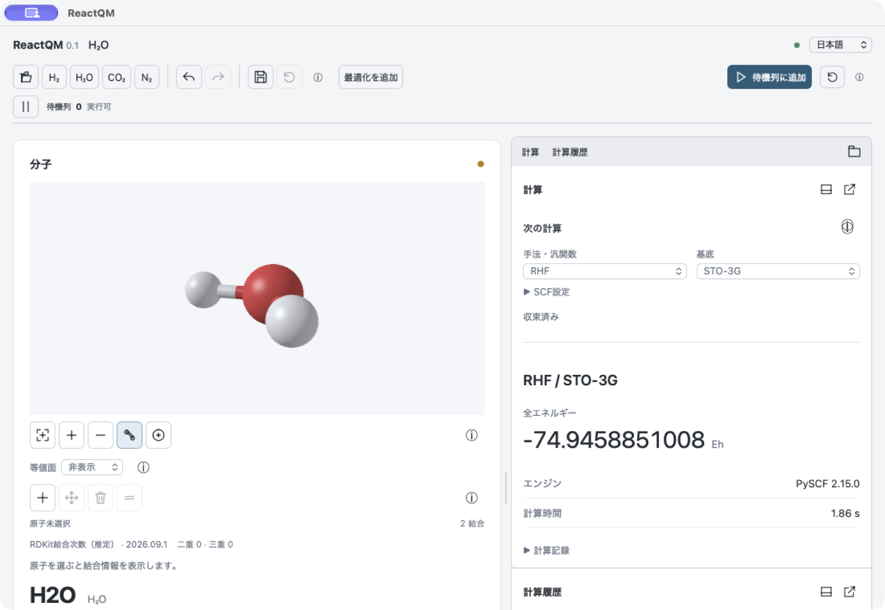

# ReactQM

Tauri 2 / Rustを中核に、React UI、Rust / wgpu描画、独立Python Workerを組み合わせる量子化学アプリです。

現在は **XYZ入力 → wgpuの分子3D表示 → 閉殻・開殻HF／DFTの実計算 → 結果表示 → 保存／再読込** がmacOSで動作します。計算履歴はSQLiteへ自動記録し、再起動後も検証して復元できます。永続待機キューで複数の計算を順に実行できます。結果・履歴パネルはドック／独立表示と配置保存に対応しました。独立窓の位置・サイズ復元と画面外回収を実装済みです。SDF／SMILES入力と初期3D構造生成に対応しています。3Dビューで原子と結合を編集できます。



macOS実画面（2026-11-17）。wgpuで描画した水分子と、待機列から実行したPySCF RHF / STO-3Gの収束結果です。全エネルギーは −74.9458851008 Eh でした。

English: ReactQM on macOS showing the 3D water molecule and a converged PySCF RHF / STO-3G calculation run through the queue.

简体中文：ReactQM 的 macOS 实际界面，展示水分子的三维模型与通过队列运行并已收敛的 PySCF RHF / STO-3G 计算结果。

- [ロードマップ](ROADMAP.md)
- [アーキテクチャ・科学計算の境界](docs/ARCHITECTURE.md)

## 必要環境とセットアップ

macOS / Apple Siliconで検証。Node.js 22.12以上（またはVite 7対応版）、npm、Rust 1.90以上、Xcode、Python 3.12、uvを使用します。

プロジェクト直下で実行します。既存のプロジェクト内キャッシュを利用する場合は、絶対パスを指定してください。

```sh
export CARGO_HOME="$PWD/.cache/cargo"
export UV_CACHE_DIR="$PWD/.cache/uv"
export npm_config_cache="$PWD/.cache/npm"
npm ci
uv sync --project worker --locked --python python3.12
cargo fetch --manifest-path src-tauri/Cargo.toml --locked
npm run tauri dev
```

Python依存は `worker/.venv` に分離します。別の仮想環境が有効でも `uv --active` は付けないでください。

UIのみ確認する場合は `npm run dev` を実行し、`http://127.0.0.1:1420/` を開きます。ブラウザでは計算・取り込み・保存を無効にし、模擬結果は表示しません。

## SDF／SMILESから分子を取り込む

「分子を取り込む」でSMILES／SDF・MOL／XYZを選び、入力して適用します。ファイルアイコンから `.sdf` / `.mol` / `.smi` / `.smiles` / `.xyz` も開けます。SMILESは `O`（水）、`CCO`（エタノール）、`c1ccccc1`（ベンゼン）などの単一文字列です。名前付き・複数行のSMILESは受け付けません。

- 単一の連結分子、入力16 KiBまで、水素を含め64原子まで。閉殻系のH/B/C/N/O/F/Si/P/S/Cl/Br/Iが対象。ラジカル・同位体・分離断片・複数SDFレコードは拒否します。
- SMILESと2D SDFは明示水素を追加し、ETKDGv3・固定seed（初期値42、0〜2147483647）・1スレッドで初期3D座標を作成します。3D SDFは既存原子の座標を保持し、必要な水素の座標を追加します。この場合seedは使いません。
- 電荷は入力構造から取得し、スピン2Sは0です。開殻分子の取り込みは、電荷とスピン多重度を指定したXYZを使用します。
- 「生成した初期構造」／「取り込んだ3D座標」を開くと、RDKit版・生成方法・seed・元入力のSHA-256を確認できます。元入力・正準SMILESを含む生成記録は保存、Undo／Redo、待機列、計算履歴、再計算入力にも保持します。
- これは量子化学的な構造最適化や最低エネルギー配座の探索ではありません。未指定の立体化学を一意に確定しません。同じ入力・seed・RDKit版と同じ実行環境で再生成を検証しており、環境をまたぐ完全一致は保証しません。
- Rustが20秒の実行上限と子プロセス回収を管理します。失敗時や、他の窓で文書が変更された場合には現在の分子を置き換えません。座標・全結合配列はWorker／Rustに保持し、UIには送信しません。

English: Import one SMILES or SDF/MOL molecule. Seeded, single-threaded ETKDGv3 generates initial coordinates for SMILES/2D SDF; 3D SDF preserves existing coordinates and adds hydrogens. Input provenance survives save, undo and calculation history. These are initial geometries, not quantum-optimized structures. Reproduction requires the same engine environment.

简体中文：可导入单个SMILES或SDF/MOL分子。SMILES／2D SDF使用固定seed、单线程ETKDGv3生成初始坐标；3D SDF保留已有坐标并添加氢。输入记录随保存、撤销及计算历史保留。这不是量子化学优化结构，精确再生成需要相同引擎环境。

統合検証は `npm run test:structure-import`：実SMILES→RDKit→Rust→PySCF→SQLite再起動・復元→プロジェクト保存／再読込の検証。科学的精度の一般的な保証ではなく、実エンジン統合と再現性の検証です。

## 最初の計算

1. ツールバーの **H₂** または **H₂O** を押すか、「XYZを取り込む」を展開してXYZを入力し「適用」を押します。ファイルアイコンからXYZファイルを選ぶこともできます。
2. 必要に応じて、取り込み前に電荷・スピン多重度（2S + 1）を設定します。
3. 計算パネルの「次の計算」で手法・基底と必要なSCF設定を選び、上部の「待機列に追加」を押します。「待機列を再開」で投入順に実行します。実行中の分子名・SCF反復数・取消操作も上部に表示します。
4. 収束した場合に全エネルギー（hartree / Eh）とエンジン版・計算時間を表示します。計算記録からjob IDと入力SHA-256を確認できます。
5. 保存アイコンで現在の分子と結果を保存します。再読込アイコンで保存時点に戻せます。再起動後も同じ保存先から再読込できます。

分子の取り込みと再読込はUndo／Redoに対応します。異なる分子へ切り替えると古い計算結果は消え、Undoでは元の構造と対応する結果を一緒に復元します。履歴は最大32段で、アプリ終了時に破棄します。

English: Use **H₂** or import a basic XYZ file, then run the RHF/STO-3G calculation. Save stores the molecule and result; Reload restores the saved project. Undo/Redo restores matching molecule/result pairs. The browser preview cannot compute.

简体中文：点击 **H₂** 或导入基本XYZ文件，然后运行RHF/STO-3G计算。保存会保留分子及结果，重新加载可恢复已保存的项目。撤销／重做会同时恢复匹配的结构与结果。浏览器预览不能执行计算。

## 計算履歴と再起動後の復元

計算カードの「計算履歴」に、実行した計算が自動で残ります。プロジェクトの保存操作をしていなくても、アプリ再起動後に履歴から分子と結果を復元できます。

- 履歴の左の矢印アイコン：入力・結果JSON・HDF5のSHA-256とサイズを照合して復元。破損・欠落した成果物は復元せず、「破損」と表示します。
- 右の再生アイコン：保存した分子と計算条件を、新しいUUIDで待機列に追加。元の試行との関係も記録します。表示中の分子は置き換えません。
- 起動時、完了記録のない実行中ジョブは「中断」にします。取り消し要求が記録されているジョブは「取消済み」にします。正常終了後の完了記録がある場合は、成果物を検証して結果を回収します。
- 履歴は20件ずつ表示します。詳細からUUID、元の試行、移行記録の検証基準を確認できます。

以前のJSON形式の履歴は、SQLite作成時に取り込みます。旧形式の成功結果は初回登録時点を整合性の基準とし、詳細に移行履歴であることを表示します。完了記録がすでにある成果物は、その既存のチェックサムを維持して再索引します。不正な入力やUUIDでは登録しません。

現在の再計算は最初からの実行です。SCFチェックポイントからの継続とHDF5配列の再読込は次の段階です。復元で行うHDF5の検査はバイト整合性の検査であり、量子化学の物理的精度の検証ではありません。

English: Calculations are recorded automatically. Restore verifies input/result/HDF5 checksums before restoring the molecule and scalar result. Recalculate starts a new attempt with the saved input and settings. Interrupted jobs restart from the beginning; checkpoint continuation is still planned.

简体中文：计算会自动记录。恢复时验证输入、结果和HDF5校验和，再恢复分子与标量结果。重新计算会按保存的输入和条件创建新任务。中断的计算从头执行；检查点续算尚未实现。

## 永続待機キューと固定ツールバー

文書名・言語切替・読み込み・Undo／Redo・保存・待機列への追加を上部に固定しました。実行状態・待機件数・一時停止／再開・実行中ジョブの取消も、スクロール位置にかかわらず操作できます。分子表示や履歴はその下をスクロールします。操作エラーも上部に表示し、閉じるボタンで消せます。

- 追加時点の入力・計算条件をSQLiteと入力ファイルに固定し、投入順（FIFO）に1件ずつ実行します。待機は最大100件、一覧は20件ずつ表示します。
- 実行中でも別の分子を読み込み、次の計算を追加できます。編集中の文書が変わった場合や再起動前に投入したジョブの結果は、履歴から復元します。同一セッションで入力を変更していない場合のみ現在の結果へ反映します。
- 一時停止は次のジョブの開始を止めます。実行中の計算は継続します。停止する場合は上部の取消ボタンを使います。
- 待機行の停止アイコンで、そのジョブだけを取り消せます。取り消した待機ジョブはWorkerを起動しません。すでに実行が始まっていた場合は状態を更新し、上部から実行中の計算を取り消します。
- アプリ再起動後も待機ジョブのUUID・入力・順序を保持し、一時停止で復元します。「待機列を再開」で続けます。通常終了では新規開始を止め、実行中ジョブを取り消して子プロセスの回収を待ち、後続の待機列を残します。
- Workerの計算失敗や取消後も、実行可であれば次へ進みます。成果物の記録・保存に失敗した場合は待機列を一時停止します。

English: Add immutable inputs to the FIFO queue and resume from the pinned toolbar. One Worker runs at a time. Pausing does not stop the active job; waiting jobs can be cancelled individually. Restart preserves pending UUIDs and order, with the queue paused until resumed. Input editing stays available while jobs run.

简体中文：将固定输入加入FIFO队列，并从顶部固定工具栏继续执行。每次只运行一个Worker。暂停不会停止当前计算，可单独取消等待任务。重启后保留等待任务的UUID和顺序，点击继续后再执行。计算过程中仍可编辑分子输入。

## パネルのドッキングと独立表示

計算結果と履歴・待機列を、右側／下部のドックまたは独立ウインドウに配置できます。各パネルのアイコンから移動先を選べます。パネル名をドックへドラッグすると移動し、タブ上へ重ねると並べ替えます。ドック右端のアイコンでタブ／分割表示を切り替えます。

- 右側の境界をドラッグ、または境界へTabでフォーカスして左右キーで幅を変更します。狭い窓では縦に並べます。
- 独立窓の閉じるボタンは元のドックへ戻します。メイン窓の上部から独立パネルを再表示できます。
- パネルの順序・ドック先・タブ選択・表示形式・幅を自動保存し、再起動時に復元します。独立窓の位置とサイズも保存し、再起動・再分離時に復元します。接続中の画面の作業領域へ補正するため、取り外した画面の座標にも復帰できます。上部の独立パネル再表示でも最小化を解除し、画面内へ回収します。
- 全窓が同じRustの文書・計算結果・キューを表示します。独立履歴からの復元もメイン文書とUndoへ反映します。独立表示だけで新しいWorkerは起動しません。
- 上部の配置リセットで標準配置に戻せます。不正な配置ファイルは初期化せず、エラーとリセット操作を表示します。
- 分子のMetal描画はメイン窓に保持します。独立窓への分子描画面の移動は後続項目です。
- パネル名へTabでフォーカスし、Alt+→で右、Alt+↓で下、Alt+↑で独立表示。Alt+Shift+←／→で同じドック内を並べ替えます（MacではAltはOption）。移動後は移動先へフォーカスが戻り、固定ツールバーに隠れないようスクロールを補正します。独立窓の初回表示と再表示では見出しへフォーカスします。

English: Focus a panel title. Alt+Right/Down/Up docks right/below or floats; Alt+Shift+Left/Right reorders. On Mac, use Option. Focus follows the panel, including redocking and reopening a minimized window.

简体中文：聚焦面板标题后，Alt+→／↓／↑分别停靠到右侧／底部或浮动，Alt+Shift+←／→调整顺序。Mac使用Option键。移动、重新停靠及重新显示后，焦点会回到目标面板。

English: Move result/history panels to the side or lower dock, group them as tabs, resize the side dock, or float them in native windows. Close a floating window to redock it. Layout is restored after restart; all windows share the same Rust document. Floating-window position and size are restored and clamped to the available monitor work area; showing a panel recovers offscreen windows. Molecule detachment is still planned.

简体中文：结果和历史面板可停靠到右侧或底部、合并为标签页、调整侧栏宽度，或在原生独立窗口中显示。关闭独立窗口会返回原停靠区。重启后恢复布局，所有窗口共享同一Rust文档。独立窗口的位置和大小会恢复并调整到当前屏幕的工作区域，重新显示可找回屏幕外的窗口。分子视图分离尚未实现。

## 分子の3D表示

macOSではRustが所有するwgpu / Metal描画面をWebViewの予約領域に重ねます。原子配列・メッシュ・描画フレームはJavaScriptへ転送しません。H₂Oサンプルで球棒モデルの奥行きと元素色を確認できます。

- ドラッグ／矢印キー：回転。スクロール／＋・−：拡大縮小。
- 全体表示ボタン／F／Home：カメラを初期位置へ戻す。
- 原子をクリック／Enter／原子選択ボタン：選択。元素・1始まりの番号・Å座標を表示。
- 原子を選択するとRDKitが原子価を自動推定し、形式電荷・RDKitバージョンも表示します。「推定接続数」は従来の距離由来の表示用結合の隣接数として分離します。ⓘをhover／focusすると説明します。
- 「分子の電荷」は分子全体の正味の電荷。0は中性、正は+、負は−を付けて表示します。原子価とは別の量です。
- 結合アイコン：距離から推定した結合の表示切替。説明はⓘのhover／focusに表示。

上部の **CO₂** サンプルで二重結合、**N₂** サンプルで三重結合をすぐ確認できます。分子の読み込み時にRDKitが結合次数を自動推定します。二重結合は2本、三重結合は3本の平行な棒で表示し、端点は各元素の色で描きます。回転に合わせて棒の並びを調整します。芳香環は一つのケクレ構造として単／二重を表示し、非局在化を確定する図ではありません。

判定前・対象外・失敗時は `距離 ≤ 1.2 × 共有結合半径の和` による表示用結合へ戻し（希ガスを除外）、「距離推定のみ・次数未判定」と表示します。RDKit反映時にはバージョンと二重／三重の件数を表示します。結合表示ボタンで全結合を隠せます。原子の大きさも模式的です。カメラ・選択・結合の表示設定は保存されず、分子変更時はカメラと選択をリセットします。

English: Drag or use arrow keys to rotate, scroll or +/− to zoom, F to fit, click or Enter to select atoms. RDKit-estimated double/triple bonds use 2/3 parallel rods; aromatic rings use one Kekulé assignment. Before/without assignment, the UI identifies distance-based hints with unassigned orders. The 3D surface currently requires the macOS Tauri application.

简体中文：拖动或方向键旋转，滚动或+/−缩放，F显示全貌，点击或Enter选择原子。RDKit推测的双键／三键以2／3根平行棒显示，芳香环使用一种凯库勒结构。未判定或失败时，会明确标记为仅按距离显示、键级未定。3D视图目前需要macOS Tauri应用。

2026-11-08：原子価と電荷を区別する表示を追加。用語は[IUPACの原子価の定義](https://goldbook.iupac.org/terms/view/V06588)を参照しました。当初は原子価を未判定と表示していましたが、現在は下記の自動推定に対応しています。macOS実画面のH₂O選択でOの推定接続数2、Hの1を確認しました。UIは日英中・320／375／1100px・明暗・キーボード説明表示を検証。Rustテスト31件＋プロセステスト2件は直列実行で成功しました。並列実行では既存の履歴再生成テストが一度`workspace_in_use`で失敗しており、並列テストの安定性は継続確認します。

## 原子価の自動推定

分子の読み込み時（原子の選択前）に、Rustが独立Python WorkerのRDKitへXYZ座標と分子電荷を渡し、`DetermineBonds`で結合次数を推定します。原子価はその原子の結合次数の和として表示します。たとえばCO₂のCは接続相手が2個でも原子価は4、H₂OのOは2となります。形式電荷は別の推定値です。[RDKitの結合推定API](https://www.rdkit.org/docs/source/rdkit.Chem.rdDetermineBonds.html)と[原子価検証](https://www.rdkit.org/docs/RDKit_Book.html#valence-calculation-and-allowed-valences)を使用します。

- 水素を省略せず、全原子の座標を入力してください。対応は閉殻系（2S=0）のH/B/C/N/O/F/Si/P/S/Cl/Br/Iです。量子計算の対応元素・手法の制限は従来どおりです。
- 値には「自動推定」とRDKit版を併記します。未対応元素・開殻系は「対象外」、不整合な座標／電荷や未割当は「判定できません」とし、値を捏造しません。Worker不在・10秒timeoutの案内と再判定ボタンがあります。
- 最大64原子、探索は1000反復。重い処理はRustの文書ロック外で実行し、最大8入力をセッション内キャッシュします。座標・全結合配列はUIへ転送しません。Undo／復元／別文書への切替で古い値を反映しません。
- これは座標と電荷に基づく構造仮説で、共鳴構造や電子状態の一意性・物理的正しさを保証しません。量子計算、プロジェクト保存内容、Undoは変更しません。3Dには推定結合次数を反映します。再起動後は現在のRDKitで再推定します。

English: Selecting an atom automatically estimates its valence (bond-order sum) and formal charge using RDKit and the whole molecule’s charge. Explicit hydrogens and supported closed-shell main-group atoms are required. Results are labeled estimates with the RDKit version; unsupported/failed cases show a reason and retry action. 3D uses the estimated orders when available, with an explicitly labeled distance-hint fallback.

简体中文：选择原子后，RDKit根据坐标及分子总电荷自动推测原子价（键级总和）和形式电荷。须显式包含氢原子，并仅支持指定的闭壳层主族体系。结果标明推测及RDKit版本，不支持或失败时显示原因并可重试。3D显示成功推测的键级，否则明确标记为距离推测。

## 分子エディター

3Dビュー下の編集ツールで、元素記号とXYZ座標（Å）を入力して原子を追加します。原子は3D上のクリックかEnterで選択できます。移動はShift＋ドラッグ、または「原子を移動」でXYZ座標を入力します。「原子を削除」は選択原子とその結合を取り除きます。

結合は、最初の原子を選んで「結合を編集」を押し、次に相手を選びます。結合なし・単結合・二重結合・三重結合から選べます。最初の結合編集時に表示中の結合一覧を取り込み、その後は手動編集した結合を3D表示とプロジェクト保存に使用します。手動結合の原子価は結合次数の合計です。

上部のUndo／Redoで編集を1操作ずつ戻せます。原子の追加・削除後に現在の多重度が電子数と合わなくなった場合は、整合する最小の多重度に切り替わります。

English: Add atoms by element and XYZ, select in 3D, and move with Shift-drag or exact coordinates. Select two atoms to add, remove, or change a bond. Edits support Undo/Redo and project save.

简体中文：按元素和XYZ坐标添加原子，在三维视图中选取原子，按住Shift拖动或输入精确坐标进行移动。选择两个原子可添加、移除或修改化学键。编辑支持撤销、重做和项目保存。

## 現在の計算範囲

- 基本XYZの単一フレーム、Å単位、1〜64原子、最大16 KiB。
- 有限座標、原子間距離0.1 Å以上、|座標| ≤ 10,000 Å、|電荷| ≤ 64、電子数とスピンの整合性をRustで検証。
- 文書としては全元素を識別しますが、**PySCFの実計算はH〜Ne** が対象です。RHF／UHF、RKS／UKS（PBE／PBE0／B3LYP）とSTO-3G／6-31G／def2-SVPを選べます。
- SCFは1〜50反復、エネルギー収束閾値 `1e-12`〜`1e-6` Eh（既定50反復・`1e-9`）、DFTグリッド3／5、タイムアウト120秒。同時実行は1ジョブです。
- 全エネルギーは核間反発を含み、ZPE・熱補正は含みません。収束は物理的精度や反応予測の正しさを保証する表示ではありません。
- 未収束・異常終了・不正応答・入力との不一致は結果として採用しません。

H₂サンプルは0.74 Å、電荷0、2S = 0。検証値は約 **−1.1167593074 hartree** です。

## HF／DFTの計算条件

「次の計算」で手法・基底を変更すると、Rustの共有Projectへ反映し、Undo／Redo・保存／再読込にも保持します。変更は以降に投入するジョブへ適用します。表示済みの結果は消さず、その結果の実行条件を別に表示します。待機列・履歴にも条件を表示し、再計算は当時の条件を保持します。

XYZ取り込み時、または読み込んだ分子の「スピン多重度」で、二重項なら2、三重項なら3を指定します。電子数と整合する値を受理し、非零スピンを指定するとRHF／RKSはそれぞれUHF／UKSへ切り替わります。単一点計算と構造最適化の両方でこの設定を使用します。UHF／UKSの結果は、計算した⟨S²⟩を目標値S(S+1)と並べて表示します。DFTの分散補正は含みません。SCFの数値収束や高いグリッド設定が物理的精度を保証するものではありません。グリッド依存性の自動評価は後続です。

新規ジョブはmethod・basis・xc・max_cycle・conv_tol・grid_levelを入力／結果に記録し、Rustで完全一致を検査します。HDF5には同じ条件、PySCF版、DFTではLibXC版、エネルギーEh・勾配hartree/bohr・座標Åを保存します。保存Projectはschema v2で次の条件を含み、v1も読み込めます。既存の要求・結果の新フィールドは省略したまま往復するため、既存receiptのhashを作り直しません。

`npm run test:settings` は実PBE／6-31GのH₂を永続キューへ投入し、再起動、実行、receipt検証、条件付き復元、Project v2、再計算条件を確認します。実測は−1.161904411329 Eh。Pythonでは4手法×3基底を同条件の直接PySCF実行と比較しました。macOS実画面でも保存条件読込→実計算→条件付き結果を確認しています。

English: Set spin multiplicity during XYZ import or in the molecule panel. UHF and UKS (PBE/PBE0/B3LYP) support single-point calculations and geometry optimization, with computed and target ⟨S²⟩ shown in results. Queued inputs and historical results retain their original settings; retry reproduces those settings. H–Ne; no dispersion correction. Project v2 stores settings and reads v1.

简体中文：可在XYZ导入时或分子面板中设置自旋多重度。UHF和UKS（PBE／PBE0／B3LYP）支持单点计算及结构优化，结果显示计算得到的⟨S²⟩和目标值。加入队列后条件固定，结果显示实际执行条件，重新计算保留原条件。支持H–Ne，不含色散校正。Project v2保存条件并兼容读取v1。

## 反応物・生成物の登録

分子パネルの「反応物・生成物」を開き、3Dビューの現在の分子をそれぞれの端点として登録します。両方が揃い、原子数・元素組成・電荷・スピン多重度が一致すると原子対応を指定できます。候補は同じ元素を原子番号順に対応させたものです。同じ元素の原子が複数あるときは、意図した組を確認して「原子対応を確定」を押してください。登録した端点と確定した対応はローカル作業領域に保存し、端点を更新すると対応を再確定できます。

## NEB／CI-NEB

1. 反応物と生成物を登録し、原子対応を確定します。二つの構造を同じ座標系に揃えてください。
2. 計算パネルでPySCFの条件を選び、「反応物・生成物」の「NEBを追加」または「CI-NEBを追加」から待機列に投入します。
3. 完了したジョブを履歴から復元します。3Dビュー下の表で各イメージのエネルギー・最大原子力を比較し、番号を押して同じ視点で構造を切り替えます。

対象はPySCFの対応元素H〜Neの2〜16原子です。端点を固定し、線形補間で全5イメージを作成します。ASE FIREで最大50ステップ・600秒、最大投影力0.05 eV/Å未満を収束条件とします。停止後は履歴の再開ボタンから最後に評価した全イメージを使い、FIREの内部状態を初期化して新規試行を追加します。HDF5には全イメージの座標・エネルギー・力を保存します。反復ごとの指標はジョブフォルダのログに記録します。遷移状態の確認は振動数・IRCの段階で行います。

`npm run test:neb` で、H + H₂ のモデル経路の実計算、停止、SQLite再オープン、再開、復元・保存を検証できます。

## 遷移状態・振動数・IRC

```sh
uv sync --project worker --locked --extra transition
npm run test:transition
```

収束済みCI-NEBの履歴にある「遷移状態・振動数・IRCを追加」を押します。最高エネルギーが内部イメージにある場合に、その座標とCI-NEBで固定したPySCF条件を使います。完了後、履歴の復元ボタンから遷移状態の3D構造、振動数、IRC両方向の端点照合を確認できます。

Sellaで一次鞍点を最適化し、PySCFの解析ヘッセ行列から並進・回転を除いた振動数を求めます。−20 cm⁻¹未満の虚振動が1つの場合に限りIRCを実行します。両方向が収束し、原子対応を保った剛体重ね合わせ後のRMSDがそれぞれの端点に対して0.35 Å以下で、もう一方より0.05 Å以上近い場合に接続確認と表示します。これは指定した計算条件と端点に対する数値判定です。

振動数、ヘッセ行列、IRC両方向の座標、端点判定と閾値はHDF5に保存します。上限は遷移状態最適化35ステップ・IRC各方向120ステップ・ジョブ全体600秒です。

English: Queue transition verification from a completed CI-NEB job, then restore the result to inspect frequencies and both IRC endpoint matches.

简体中文：从已完成的 CI-NEB 任务加入过渡态验证，恢复结果后可查看振动频率及双向 IRC 的端点匹配。

## 電子エネルギー障壁を比較する

計算履歴で完了済みのNEB、CI-NEB、遷移状態結果を最大2件選び、「障壁を比較」を押します。正・逆方向の障壁と反応エネルギーをkJ/molで表示します。経路の障壁は最大サンプル、遷移状態の障壁は最適化した鞍点から計算し、いずれも元経路の反応物・生成物エネルギーを参照します。詳細からイメージごとの相対エネルギー、条件、元ジョブを確認できます。ZPE補正と自由エネルギー障壁は熱化学結果に表示します。

## 端点熱化学と自由エネルギー

計算履歴から両方向IRCを確認済みの遷移状態を復元し、結果パネルで温度（1〜2000 K、初期値298.15 K）を指定して「熱化学を待機列に追加」を押します。完了結果を履歴から復元すると、ZPE補正後の障壁と自由エネルギー障壁を正逆方向で表示します。詳細に3構造の振動数と最大原子力を表示します。

元のCI-NEB端点と最適化済みの鞍点を固定し、同一のPySCF条件で解析振動数を再計算します。気相1 atmの剛体回転子・調和振動子（RRHO）モデルを用い、各構造を単一化学種として扱います。端点は事前に最適化した構造を登録してください。最大原子力0.03 eV/Å以上、絶対値20 cm⁻¹以下のモード、または端点0・鞍点1以外の虚振動数では、該当する障壁を表示しません。鞍点の反応方向モードを熱分配関数から除きます。

`npm run test:thermochemistry` は実CI-NEB・IRCから診断付き結果を保存・復元する統合検証です。HCN／HNCの正逆障壁と温度依存性はWorkerの実計算テストで検証します。

熱化学の「振動エントロピー」では、従来のRRHOとGrimme quasi-RRHO（基準100 cm⁻¹）を選択できます。補正は振動エントロピーに適用します。ZPEと振動エンタルピーには調和振動数を使い、極小・鞍点の採用基準は共通です。選択したモデルは熱化学結果と速度比較に表示されます。

## 溶媒モデルと標準状態

熱化学ジョブの投入時に、標準状態を1 atm／1 Mから、溶媒モデルを気相／C-PCM／IEF-PCMから選択します。PCMの溶媒は水とアセトニトリルです。PCMを選んだ結果には、同じ標準状態と温度で気相・溶液のGibbs障壁が正逆方向で並びます。

溶液値は気相構造のPCM単一点エネルギーに気相RRHO熱補正を加えた近似です。溶液中での再最適化、溶液ヘッセ行列、非静電的溶媒和項は含みません。1 atmから1 Mへは各化学種のGに RT ln(C°RT/p°) を加えます。各側を単一化学種として扱う現行経路では、この項は障壁差で相殺されます。温度、標準状態、溶媒、誘電率、PCM設定と気相・溶媒中のエネルギーを成果物に保存します。

### 多化学種の標準状態換算

計算履歴の「多化学種の熱化学」を開き、完了済みの気相ジョブから反応物・生成物を選んで係数を指定します。必要に応じて鞍点ジョブを選び、温度と振動エントロピーのモデルを設定して待機列に追加します。完了後に履歴から復元すると、計算パネルで反応式と1 atm／1 Mの反応・正逆活性化自由エネルギーを比較できます。

各側1〜8項、各係数1〜16、化学種当たり1〜16原子が対象です。全化学種で電子状態計算の設定を揃えます。鞍点を省略した場合は反応自由エネルギーを比較できます。指定した鞍点と端点の経路接続は別途IRCで確認してください。

#### Worker CLI

気相の最適化済み化学種を個別のPySCF単一点ジョブ入力として用意し、化学量論をJSONで指定します。パスはマニフェストからの相対パスです。以下は同じ組成を両側に持つ交換反応の指定例です。

```json
{
  "temperature_kelvin": 298.15,
  "reactants": [{"input": "H.json", "coefficient": 1}, {"input": "H2.json", "coefficient": 1}],
  "products": [{"input": "H2.json", "coefficient": 1}, {"input": "H.json", "coefficient": 1}],
  "saddle": "H3-saddle.json"
}
```

```sh
uv run --project worker --locked python -m reactqm_worker stoichiometry --input reaction.json > comparison.json
```

元素数・電荷の保存と共通の電子状態計算条件を検証します。各化学種を独立に振動数解析し、1 atmと1 Mで、反応自由エネルギーと指定した鞍点の正逆の活性化自由エネルギーをkJ/molで出力します。鞍点を省略すると反応自由エネルギーのみを出力します。鞍点は一次鞍点の振動数基準を満たす必要があり、経路の接続は別途IRCで確認してください。

1 Mへの補正は化学種1モル当たり `RT ln(C°RT/p°)` です。反応には生成物と反応物の係数和の差、障壁には鞍点1から各側の係数和を引いた値を掛けます。RRHOを既定とし、`"quasi_rrho": true` で振動エントロピー補正を選択できます。

### 溶液中の構造最適化・振動数

閉殻分子（2〜10原子）を読み込み、計算手法をRHFに設定します。計算パネルの「溶液中の最適化・振動数」でモデルと溶媒を選んで待機列に追加します。上部に最適化ステップと振動数解析の進捗が表示されます。完了後に計算履歴から復元すると、最適化構造が3Dビューに表示され、計算パネルで振動数・最大力・極小判定を確認できます。

#### Worker CLI

保存済みRHF単一点ジョブの `input.json` から、気相の初期構造をPCM溶媒中で緩和し、同じ溶媒条件で調和振動数を求めます。対象は2〜10原子の閉殻系です。

```sh
uv run --project worker --locked python -m reactqm_worker solution   --input path/to/input.json --output-dir solution-run   --solvent-model c_pcm --solvent water --steps 50
```

`--solvent-model` は `c_pcm`／`ief_pcm`、`--solvent` は `water`／`acetonitrile` です。最大力が0.01 eV/Å未満に達するとヘッセ行列を計算します。溶媒条件・入力・構造・ヘッセ行列・符号付き振動数は `solution.h5`、収束診断と振動数は `solution-result.json` に保存します。全振動モードが20 cm⁻¹を超えた場合に極小確認フラグを立てます。

### 溶液中の遷移状態と電子エネルギー障壁

計算履歴から、両方向のIRCを検証済みの気相RHF遷移状態を復元します。計算結果の「溶液中の遷移状態・障壁」でPCMモデルと溶媒を指定し、待機列に追加します。上部に反応物・生成物の最適化、鞍点、振動数、IRC正逆の段階が表示されます。待機中・実行中は既存の取消操作を使えます。

完了した結果を履歴から復元すると、3DビューでIRCの方向とフレームを選べます。障壁表は気相の保存済みCI-NEB端点と鞍点、およびPCMで緩和した両端点と鞍点の電子エネルギー差を比較します。溶液側は経路未確認時に空欄になります。

#### Worker CLI

原子対応付きの遷移状態ジョブの `input.json` を指定します。保存された鞍点探索の初期構造と両端点から、同じPCM条件で構造最適化、振動数解析、両方向のIRCを行います。

```sh
uv run --project worker --locked python -m reactqm_worker solution-path \
  --input path/to/transition/input.json --output-dir solution-path-run \
  --solvent-model c_pcm --solvent water
```

両端点が極小で、鞍点の有意な虚振動が1つあり、IRCがそれぞれ緩和後の端点に接続する場合に、正逆の電子エネルギー障壁を kJ/mol で出力します。構造・ヘッセ行列・IRC軌跡は `path.h5`、判定と障壁は `path-result.json` に保存します。閉殻RHFの2〜10原子が対象です。

## Eyring速度定数と条件比較

計算履歴で完了済みの熱化学結果を最大2件選び、「速度定数を比較」を押します。温度・標準状態・溶媒別に、正逆の自由エネルギー障壁と速度定数（s⁻¹）を確認できます。比較は同じ遷移状態の元ジョブと電子状態の条件を基準にします。

Eyring式 k = (k_B T / h) exp(−ΔG‡/RT) を透過係数κ=1で評価します。各側が単一化学種の一次過程が対象です。気相RRHO、または固定気相構造のPCMと気相RRHO補正を使用し、トンネル効果・再交差・拡散を含めません。共通の標準状態補正は障壁差で相殺されます。自由エネルギー障壁が未算出、または0以下の場合は速度定数を表示しません。

`npm run test:rates` はHCN／HNCの既知構造を用い、実PySCF Workerで振動・溶媒計算を実行して、保存・再読込後の速度定数を検証します。

## MP2／CCSD(T)で電子障壁を再評価する

両方向IRCを確認済みの一重項の遷移状態を履歴から復元し、結果パネルでMP2／CCSD(T)と基底関数を選んで待機列へ追加します。完了結果を履歴から復元すると、元の電子障壁、再評価した正逆の障壁、元の計算との差をkJ/molで比較できます。

元のCI-NEBの両端点と最適化済み遷移状態を固定し、全電子RHFを参照とする気相単一点を実行します。対象はH〜Ne、2〜10原子、最大64軌道、最長600秒です。比較値は電子エネルギー差です。再評価による構造緩和・振動数・溶媒・熱補正は含みません。MP2／CCSD(T)は適切な単一参照を仮定し、数値収束だけでその適切性は判断できません。

`npm run test:refinement` は固定したHCN／HNCの3構造と実PySCF計算で、両方式の障壁、永続待機列、履歴復元、プロジェクト保存を検証します。

## 軌道・電子密度の等値面

PySCFの単一点計算または構造最適化を実行し、3Dビュー下の「等値面」でHOMO、LUMO、電子密度を選択します。計算履歴から復元した結果でも利用できます。非制限計算では軌道をα・β別に表示し、占有または空軌道が存在するスピン成分を選べます。

軌道の青と赤は波動関数の正負、緑は全電子密度です。格子は40³点、表示値は軌道 ±0.03 bohr⁻³⁄²、密度 0.02電子/bohr³ です。格子が固定のため、大きな分子ほど空間分解能が粗くなります。従来のPySCF成果物は再計算すると等値面を利用できます。等値面のデータはジョブフォルダのHDF5に保持されます。

`npm run test:fields` はH₂を実計算し、SQLite再オープン後に3種類を読み戻し、wgpuの描画色と改変検出を検証します。Metalアクセスが必要です。

English: After a PySCF calculation or history restore, use the isosurface selector below the 3D view. Orbital phases are blue and red, while total density is green.

简体中文：在 PySCF 计算完成或从历史恢复后，可在三维视图下选择等值面。轨道正负相位分别以蓝色和红色显示，总电子密度以绿色显示。

## GFN2-xTBの高速スクリーニング

開発環境のWorkerにオプションのtbliteを追加します。検証環境はApple Silicon macOS、Python 3.12、tblite 0.8.0です。macOSの公式ホイールはmacOS 15以降を対象とします。

```sh
uv sync --project worker --locked --extra screening
npm run test:screening
```

計算パネルで **GFN2-xTB** を選び、上部の「待機列に追加」を押します。対応範囲はH〜Rn、1〜64原子、電荷と電子数が整合する一重項です。気相の単一点計算をSCC最大250反復・精度設定1.0・電子温度300 Kで実行します。構造候補のエネルギーは同じ手法・組成・電荷の範囲で比較します。

結果パネルに全エネルギー（Eh）とtblite版を表示します。履歴から検証付きで復元・再計算でき、プロジェクトとして保存できます。HDF5には勾配（hartree/bohr）、座標（Å）、電荷、多重度、収束と実行条件を保存します。

English: Install the optional screening extra, select GFN2-xTB and add a single-point job to the queue. The result, conditions and engine version are available in history and project saves.

简体中文：安装可选的筛选依赖，选择 GFN2-xTB 并将单点任务加入队列。历史记录和项目保存包含结果、计算条件和引擎版本。

## デスクトップでの構造最適化

分子を開き、計算パネルで手法と基底を選んで「最適化を追加」を押します。待機列を再開するとASE BFGSが実行され、上部に構造ステップが表示されます。既存の取消ボタンで待機中・実行中のジョブを取り消せます。1試行は最大50ステップ・600秒で、最大力が0.05 eV/Å未満になると収束します。

評価済み座標のある取消・中断・失敗ジョブは、履歴の「保存座標から再開」で同じ計算条件の新しい試行を追加できます。最後に評価した座標を初期値とし、BFGSの近似ヘッセ行列は初期化します。通常の「保存条件で再計算」は、その試行の入力座標から開始します。

収束時、投入時の文書と条件を表示し続けていた場合は、最適化した構造と結果を3Dビューへ反映します。別の文書に移った場合や再起動後は、計算履歴から検証して復元できます。自動反映はUndoで戻せます。

## 構造最適化（Worker CLI）

完了済み計算などの `input.json` を使い、ASE BFGSで構造を緩和できます。以下はmacOSでリポジトリ直下から実行する例です。出力先には新しいディレクトリを指定してください。

```sh
PYTHONPATH=worker/src worker/.venv/bin/python -m reactqm_worker optimize \
  --input /path/to/job/input.json --output-dir /path/to/new-optimization \
  --fmax 0.05 --steps 50
```

`--fmax` は最大原子力の閾値（eV/Å）、`--steps` は1回あたりのステップ上限です。終了コード0は収束、2はステップ上限、1はエラーです。停止後は同じ入力・閾値・出力先で `--resume` を付けると、最後に評価できた座標から再開します。再開時にBFGSの近似ヘッセ行列を初期化します。収束後は `optimization-result.json` と `optimized.xyz` が作成されます。XYZをアプリで開く際は、元の電荷とスピンを指定してください。デスクトップでは上記の待機列から実行できます。

## 保存先と開発用設定

通常はTauriのアプリデータ領域（このmacOSでは `~/Library/Application Support/dev.reactqm.desktop`）に保存します。

- `jobs.sqlite3`、`jobs.sqlite3-wal`、`jobs.sqlite3-shm`：SQLite計算索引とトランザクション用ファイル。
- `workspace.lock`：作業領域の排他ロック。同じ領域への二重起動時は計算・保存を止めます。
- `layout.json`：schema v1のパネル配置。文書・原子配列・計算成果物を含みません。
- `workspace.json`：保存操作をした時点の分子・結果・次回計算条件（schema v2、v1も読込可能）。現在は単一の保存スロットです。
- `jobs/<UUID>/input.json`：条件・原子配置・単位・入力hash。
- `jobs/<UUID>/worker.log`：Workerの診断ログ。
- `jobs/<UUID>/result.h5`：座標・エネルギー・勾配と単位属性。
- `jobs/<UUID>/result.json`、`status.json`：成功結果・終了状態。
- `jobs/<UUID>/completion.json`：正常終了後にRustが作成する、入力・結果・HDF5のSHA-256とサイズ。SQLiteにも完了記録自体のSHA-256を保持します。

保存は一時ファイルからの原子的置換です。破損したプロジェクトは読み込まず、現在の状態を維持します。成果物は保存ボタンと独立してjobフォルダに残り、SQLite履歴から検証して復元できます。DBの破損や未対応バージョンを検出した際にデータを自動で初期化することはありません。

環境変数 `REACTQM_DATA_DIR` で保存先、`REACTQM_PYTHON` でPython実行ファイルを上書きできます。絶対パスを指定してください。UI検証では `/private/tmp/reactqm-ui-qa` を使用しました。

Workerは現在のチェックアウトのソースとvenvを使います。開発用.appは単体配布できる完成品ではありません。

## 検証コマンド

```sh
npm run build
npm run test:rust
npm run test:worker
npm run test:integration
npm run test:catalog
npm run test:settings
npm run test:queue
npm run check:worker
npm run check:gpu
npm run test:render
npm run test:bond-render
cargo clippy --manifest-path src-tauri/Cargo.toml --all-targets --locked -- -D warnings
```

`test:bond-render` は実RDKitのCO₂／N₂の結合次数をRustで保持し、wgpuで描画します。単／二重／三重の棒を画像断面で数え、部分表示の画素一致・回転・明暗・縦長も確認します。画像は `/private/tmp/reactqm-bond-render/` に出力し、`REACTQM_BOND_RENDER_OUTPUT` で出力先を変更できます。真正面から結合軸を見た際の原子による遮蔽は通常の3D表示どおりです。

`test:rust` のプロセステストには `worker/.venv` が必要です。`test:integration` は実際にRustからWorkerを起動し、H₂計算・HDF5生成・結果の保存／再読込まで確認します。`check:gpu` はadapter / deviceの初期化です。`test:render` は実GPUで通常・部分表示・選択・回転／暗色・縦長の5画像を描き、空白画像・元素色・選択色・部分表示の画素一致を検証します。画像は `/private/tmp/reactqm-render/` に出力し、`REACTQM_RENDER_OUTPUT` で出力先を変更できます。画素の読み戻しは検証用Rustプロセス内に限定しています。

2026-11-06に描画・基本計算を、2026-11-07に履歴・復旧機能を検証しました。環境はApple M4 / arm64、Node 26.12.1、Rust 1.99.1、Python 3.12.16です。

| 確認内容 | 結果 |
|---|---|
| Web型検査・本番ビルド、macOS開発用.app | 成功 |
| Rust unit 39件 + process 2件 | 成功。履歴・復元・破損拒否・取消競合・別プロセス終了・排他・ページ分割・既存検証基準の維持を含む |
| Python 14件 | 成功 |
| Clippy / all-targets / warnings-as-errors | 成功 |
| HF／DFT設定 | RHF／PBE／PBE0／B3LYP × 3基底を直接PySCFと比較。DFTグリッド5・不正条件・非収束・条件保存・旧データ互換を確認 |
| DFTの縦断検証 | PBE／6-31G −1.161904411329 Eh、永続キュー・再起動・receipt・復元・再計算・Project v2・macOS実画面を確認 |
| Rust→Worker→PySCF→HDF5→保存／再読込 | 成功、H₂ −1.1167593073964257 hartree |
| Worker異常系 | 異常終了・不正／過大応答・別job ID・未収束・無応答／大量出力のtimeout・取消と子プロセス回収を確認 |
| Tauri実画面 | H₂実計算、保存／再読込、不正座標拒否、分子変更、Undo／Redo、取消後の操作復帰を確認 |
| Chromeプレビュー | 日英中、320 / 375 / 1100px、明暗テーマ、keyboard tooltip、横はみ出しなし |
| ブラウザエラー | ページ識別・空白画面・Vite overlay・consoleを確認、エラーなし |
| wgpu描画プローブ | Apple M4 / Metal、4×MSAA、5ケース成功。部分表示が元画像の対応範囲と一致 |
| ネイティブ3D表示 | H₂ / H₂O、回転・ズーム・全体表示・原子選択・結合切替、1100×760 → 1025×1242 → 元サイズ、スクロール、H₂実計算・履歴同期を確認 |
| 永続化の実計算プローブ | H₂の実計算を2回実行し、SQLite・再生成後の復元・試行の関連・破損の隔離を確認 |
| 履歴のTauri実画面 | 保存ボタンなしの終了／再起動 → 復元 → 再計算 → 取消 → 破損拒否 → 正常な結果の復元を確認 |
| 永続キュープローブ | 実H₂計算2件、FIFO・再起動後の保持・待機取消でWorker未起動・単一claim・Worker失敗後の継続を確認 |
| キューのTauri実画面 | H₂／H₂O追加・待機取消・再起動・一時停止・実行中終了・後続保持・H₂O再開と結果復元を確認 |
| 固定ツールバー | 主要操作とキュー操作を上部固定。Metalの切り取りとポップアップを含むスクロールを確認 |
| 履歴の画面レイアウト | 画面検査用データで日英中、320 / 375 / 1100px、明暗、ページ分割／再読込、長い名前、操作不可状態を確認。consoleエラーなし |
| 二重／三重結合描画 | 実RDKit→GPUでCO₂二重・N₂三重の棒を画素断面で確認（1／2／3本）。部分スクロールの画素一致、回転・暗色・縦長、従来5描画ケースを確認。macOS実画面でCO₂／N₂自動反映・表示切替・回転・原子選択も確認 |
| 自動原子価 | 実RDKitで単／二重／三重／芳香族・荷電分子・失敗例、Rust経由CO₂とtimeout／取消、3言語UIの再判定・遅延応答破棄を検証。macOS実画面でCO₂のC＝4・形式電荷0・接続数2・RDKit版を確認 |
| パネルの実画面 | 結果／履歴の独立窓、閉じた際の再ドック、下部タブ、起動時の配置復元、独立履歴からの共有文書復元、実H₂Oの結果表示を確認 |
| パネルのブラウザ検証 | 実ポインタドラッグ・キーボード幅調整、タブ／分割／移動、日英中 × 320 / 375 / 1100px × 明暗。横はみ出し・consoleエラーなし |
| HiDPI・画面間移動 | ⭕️ [Pending] 1×環境で実機確認。実Retina・異倍率画面間移動・ネイティブ暗色合成は未確認 |

Browser plugin not available（browser skill/runtimeがこのセッションにない）ため、ブラウザ検証は一時導入のPlaywrightと既存Chromeを使用しています。ネイティブの操作検証はComputer Useで実施しました。Playwrightは製品依存に含めていません。

## 既知の制限

- 描画はmacOSの単一mainウインドウのみ。結果／履歴の独立窓には対応していますが、ブラウザの代替3D描画、複数の分子描画面、device lossからの自動復旧は未実装です。GPU初期化に失敗した場合はUIにエラーと再試行を表示します。
- SCFチェックポイントからの継続、待機順の手動変更／優先度、HDF5配列の再読込、DB破損の自動修復は未実装です。中断ジョブは手動で再計算できます。
- 履歴は正常終了の記録とバイト整合性を検証します。OSによる孤立Workerの回収、電源断・ディスク故障、複数マシン間での同時利用は未検証です。
- PySCFのこのwheelではOpenMPが利用できません。CPU並列化性能は未検証です。
- Rustの推移依存 `block 0.1.6` に将来のRust互換性警告があります。現在のビルド・テスト・Clippyは成功しています。
- 新しくコピーした検証用.appの初回起動でWebViewが白画面となり、再読込が必要なケースがありました。その後の起動と独立窓の復元は確認済みですが、初回起動の安定性は継続確認します。
- Metal検証では通常のホスト権限が必要です。実行サンドボックス内ではadapterが見つかりませんでした。
- Windows / Linuxのネイティブ動作、CUDA、署名・公証・別マシン配布は ⭕️ [Pending] です。

## 開発用.appとソース構成

```sh
npm run tauri -- build --debug --bundles app --no-sign --config '{"bundle":{"active":true}}'
```

生成先は `src-tauri/target/debug/bundle/macos/ReactQM.app` です。アイコンの元データは `public/reactqm.svg`。

```text
src/                       React UI・日英中の辞書
src-tauri/src/document.rs   XYZと科学入力の検証
src-tauri/src/state.rs      共有状態・履歴・revision
src-tauri/src/layout.rs     パネル配置と検証・保存
src-tauri/src/panel_windows.rs 独立窓のライフサイクルと共有配置命令
src/DockWorkspace.tsx       ドック・タブ・分割・ドラッグ・幅調整
src/useLayout.ts            revision付き配置の読取投影
src-tauri/src/jobs.rs       Workerプロトコル・プロセス管理
src-tauri/src/catalog.rs    SQLite履歴・待機列・完了記録・復元・中断検出
src-tauri/src/scheduler.rs  単一Worker・FIFO実行・一時停止・終了時回収
src/QueueToolbar.tsx        固定キュー操作
src/useQueue.ts             共有する読取専用キュー投影
src/JobHistory.tsx          履歴一覧・復元／再計算の命令
src-tauri/src/project.rs    結果検証・原子的な保存／読込
src-tauri/src/renderer.rs   Rust所有のカメラ・選択・表示状態
src-tauri/src/renderer/     wgpuパイプライン・分子メッシュ・macOS表示面
src/MoleculeViewport.tsx    表示領域・入力命令・小さな状態の投影
worker/                    独立Python環境・実計算・診断CLI
ROADMAP.md                 進捗・完了条件・次の優先順位
```

2026-11-10：独立窓の位置・サイズ保存と画面外回収を追加。`npm run test:window-geometry`は一時保存先でネイティブ窓を生成し、保存・再読込・窓再作成・画面外回収・リセットを検証します（デスクトップへのアクセスが必要）。Rust 37 unit＋2 process、`npm run build`成功。単一画面での自動API検証済み。異倍率の複数画面・画面取り外しの実機検証と、ドラッグ等の目視操作確認は保留です。

2026-11-10（パネル操作）：Rust 37 unit＋2 process、build成功。Chromeの操作fixtureでキー操作・実ドラッグ・保存失敗時のフォーカス、日英中×320／375／1100px×明暗を確認。macOSではキーボード移動・独立窓の初期フォーカス・再ドック・閉じる後の復帰・最小化から再表示・固定ヘッダー下の表示補正を確認しました。今回のネイティブ実ポインタドラッグはUI自動化で配置変更を確認できず、追加検証を保留しています。

## 分子動力学

計算パネルの「分子動力学」でNVE／Langevin、時間刻み、ステップ数、温度、乱数シードを指定し、待機列へ追加します。上部に実行ステップが表示され、待機中・実行中のジョブを取り消せます。完了後は計算履歴から復元し、3Dビューで再生・一時停止・フレーム移動ができます。軌跡はローカルのジョブ成果物に保存します。

### Worker CLI

保存済みPySCF単一点ジョブの `input.json` から、気相の2〜10原子を対象にBorn–Oppenheimer分子動力学を実行できます。新規の出力ディレクトリを指定してください。

```sh
uv run --project worker --locked python -m reactqm_worker dynamics \
  --input path/to/input.json --output-dir md-run \
  --ensemble nve --steps 80 --timestep-fs 0.25 --temperature-k 300 --seed 42
```

`nve` は温度を初期運動量のサンプリングに使用します。`langevin` は同じ温度をサーモスタットの目標値にも使用し、摩擦係数は0.02 fs⁻¹です。瞬間温度は並進・回転を含む全自由度から求めます。時間刻みは0.05〜2 fs、実行は1〜500ステップです。軌跡と入力・エンジン情報は `trajectory.h5`、温度とNVEのエネルギー偏差は `dynamics-result.json` に保存します。

## MACE-OFF23ポテンシャル

計算パネルの「MACE-OFF23-small」を開くと、対応元素・電荷・スピンと現在の入力の判定が表示されます。範囲外では待機列への追加が無効になります。完了後に履歴から復元し、エネルギー（eV）と選択した原子の力のXYZ成分（eV/Å）を確認できます。

開発版を起動する前に、`REACTQM_MACE_MODEL` に公式チェックポイントの絶対パス、`REACTQM_MACE_PYTHON` にMACEとPyTorchを含むPythonの絶対パスを設定します。後者を省略すると既存WorkerのPythonを使います。MACE専用の一時環境で起動する例です。

```sh
export REACTQM_MACE_MODEL=/absolute/path/to/MACE-OFF23_small.model
uv run --project worker --locked --with mace-torch==0.3.14 --with torch==2.9.1 \
  python -c 'import os, sys; os.environ["REACTQM_MACE_PYTHON"] = sys.executable; os.execvp("npm", ["npm", "run", "tauri", "dev"])'
```

同じ環境変数で `npm run test:mace` を実行すると、公式モデルで待機列・履歴復元を検証できます。

### Worker CLI

公式の [MACE-OFF23-smallチェックポイント](https://github.com/ACEsuit/mace-off/blob/main/mace_off23/MACE-OFF23_small.model) を取得し、公開元のモデルライセンスを確認してください。WorkerはSHA-256で照合してから読み込みます。入力はReactQMのDocument JSONです。ジョブ入力の `input.json` を使う場合は、その中の `document` を取り出します。

```sh
uv run --project worker --locked python -m reactqm_worker mace-scope
uv run --project worker --locked --with mace-torch==0.3.14 --with torch==2.9.1 \
  python -m reactqm_worker mace --input molecule.json --model-path MACE-OFF23_small.model \
  > mace-result.json
```

学習領域はSPICE v1の中性閉殻有機化学です。アダプターはH、C、N、O、F、P、S、Cl、Br、Iの2〜64原子からなる、非周期・中性・一重項の単一分子を受け付けます。電荷、指定スピン、元素、電子数の偶奇、座標、原子の極端な接近・分離を推論前に検査します。適用範囲の検査は学習分布からの外れや予測誤差を定量化しません。反応経路・結合の生成や解離、開殻性を持つ一重項の評価には使わないでください。

CPU／float64で推論し、エネルギー（eV）、各原子の力（eV/Å）、モデル・入力のハッシュと実行環境のバージョンをJSONに出力します。

### 外挿の疑いとモデル間の不一致

MACEの結果には、最短原子間距離を共有結合半径の和で割った比と、全原子が連結になる最小の距離比を表示します。最短比が0.80未満、または連結に必要な比が1.20を超える場合に、該当原子の番号と警告を表示します。

公式の [MACE-OFF23-mediumチェックポイント](https://github.com/ACEsuit/mace-off/blob/main/mace_off23/MACE-OFF23_medium.model) の絶対パスを `REACTQM_MACE_MEDIUM_MODEL` に設定すると、同じ構造を両モデルで推論します。原子ごとの力ベクトル差のノルムから最大値とRMSを表示し、最大値が0.50 eV/Åを超える場合に警告します。設定なしでは幾何の診断のみを表示します。これらの閾値は探索用の目安です。モデル間の差を誤差範囲や信頼区間として扱うことはできません。

評価セットは `worker/validation/mace_extrapolation.py` にあります。上記の任意依存を指定した `uv run` で、このスクリプトにsmall、mediumのモデルパスを順に渡すと、4分子の平衡近傍・圧縮・伸長構造を再評価できます。

外挿指標と参照力の差を比較するには、同じMACE実行環境で次を実行します。中間的な変形も含む4分子・20構造を生成し、PBE0／def2-SVPの力との比較をJSONに出力します。警告閾値は既存の値を固定し、最大力差0.50 eV/Åを超えた構造に対する検出・見逃しを集計します。

```sh
uv run --project worker --locked --with mace-torch==0.3.14 --with torch==2.9.1 \
  python worker/validation/mace_reference.py MACE-OFF23_small.model MACE-OFF23_medium.model
```

この参照はMACE-OFF23の学習時と異なる電子状態計算条件です。比較値には手法差が含まれます。

学習時と同じ参照条件で警告を評価するには、[MACE-OFF23公式テストセット](https://doi.org/10.17863/CAM.107498)の `test_large_neut_all.tar.gz` を取得し、`test_large_neut_all.xyz` を展開します。次のコマンドはアプリが受理する構造から固定シードで抽出し、公式参照力と同一座標のsmall／medium実推論を比較します。

```sh
uv run --project worker --locked --with mace-torch==0.3.14 --with torch==2.9.1 \
  python worker/validation/mace_heldout.py test_large_neut_all.xyz \
  MACE-OFF23_small.model MACE-OFF23_medium.model --samples 128 --seed 7127
```

出力JSONには入力・モデルのハッシュ、抽出したフレーム番号、除外理由、力の誤差、警告の混同行列を記録します。結果は指定した標本と最大原子力誤差0.50 eV/Åという判定基準に対応します。

分子ごとに分離して閾値を検証するには、同じ公式XYZを使って次を実行します。原子マップと立体表記を除いた分子IDで校正・検証を分け、データ種別と短距離・長距離の幾何フラグごとに抽出します。最大原子力誤差0.50 eV/Åを判定基準とし、校正側の感度と特異度の平均で候補を選び、検証側では既存閾値と選定候補を比較します。

```sh
uv run --project worker --locked --with mace-torch==0.3.14 --with torch==2.9.1 \
  python worker/validation/mace_calibration.py test_large_neut_all.xyz \
  MACE-OFF23_small.model MACE-OFF23_medium.model --per-stratum 8 --seed 5041
```

集計は層別サンプル上の値です。実利用での警告頻度や信頼区間としては使用できません。
