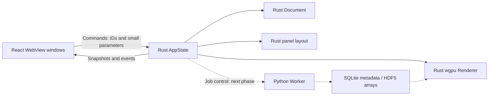

# ReactQM architecture

## Ownership

Solid edges describe ownership and command foundations present in code; dashed edges are planned integrations. The renderer currently has a device-initialization probe only. No native surface, molecular render pipeline, production job transport, or persistent database has been implemented.

## Rust / WebView boundary

- `AppState(Mutex<Workspace>)` is managed once by Tauri, independently of windows.
- `Workspace` owns `Document`, `Renderer`, `PanelLayout`, and locale.
- Current IPC commands: `workspace_snapshot`, `set_locale`. The event `workspace-changed` carries a small snapshot.
- React holds a read-only projection plus transient connection state. Browser-only preview uses local transient locale because it has no Rust process.
- Future commands address document / atom / job / viewport IDs. Do not serialize full trajectories, volumetric grids, rendered frames, or orbital arrays into JavaScript.
- Future background work must release the state lock before compute / I/O, then apply results using a document revision. Add monotonically increasing snapshot revisions before concurrent mutations and floating windows to reject stale updates.

## Native rendering: next technical milestone

Create a Rust-owned rendering service and native surface per viewport; windows register a surface and viewport ID without taking ownership of the scientific document. Validate Metal surface lifecycle, main-thread requirements, WebView composition, input hit testing, resize / scale factor, and multi-window destruction. Do not work around platform integration by transferring frames to a canvas.

## Worker boundary: planned contract

The current Python package provides `doctor` and `smoke` diagnostics only. It is not yet launched by the desktop application.

For the first integrated job, Rust launches the project-specific interpreter directly with argument arrays, never through shell interpolation. Use a versioned JSON-lines control protocol on stdio for local jobs; route engine logs to stderr. Bound message size and keep arrays in job-scoped HDF5 files. A job manifest includes:

- schema version, job ID, document revision, input checksum;
- atom identities, coordinates / unit, charge, spin (`2S`), method, basis and convergence settings;
- engine / dependency versions, threads, memory budget, random seed if used;
- status (`queued`, `running`, `succeeded`, `failed`, `cancelled`), convergence and warnings;
- artifact references, checksums and units.

Add timeout / cancellation, process-tree cleanup, exit-status checks, workspace-restricted artifact paths, atomic result writes and failure recovery before connecting long jobs to the UI. Remote execution later uses the same logical contract over authenticated HTTPS / a job queue, not direct access to the managed database.

## Units and provenance

Document coordinates: Å. Quantum energy: hartree. PySCF nuclear gradients: hartree / bohr. ASE calculator conventions require explicit conversion (energy eV, forces eV / Å), including the negative sign from gradient to force. Spin is `2S`; multiplicity is `2S + 1`. Persist units per dataset and never infer them from a filename.

The installation smoke fixture is H₂ at 0.74 Å, neutral singlet, RHF/STO-3G, approximately -1.1167593074 hartree. It checks an installed engine, finite gradients and storage roundtrips; it does not validate reaction barriers, DFT accuracy, or the future UI job pipeline.

## Persistence and deployment

Local: SQLite for manifests / job states, HDF5 for arrays; both are only smoke-tested in temporary files today. Desktop persistence is a Phase 1 deliverable. Do not open the same HDF5 result concurrently for unsynchronized writes. Prefer immutable job artifacts.

No server is required for Phase 0–3. If operations later justify XServer, keep App VPS + Managed PostgreSQL + NFS in the Cloud core; communicate with separate VPS Workers through HTTPS / a job queue. NVIDIA GPU execution and native Windows / Linux support remain environment-dependent validation items.

## Official references

- [Tauri prerequisites](https://v2.tauri.app/start/prerequisites/)
- [Tauri project setup](https://v2.tauri.app/start/create-project/)
- [wgpu Instance API](https://wgpu.rs/doc/wgpu/struct.Instance.html)
- [PySCF installation](https://pyscf.org/user/install.html)

Installed versions are recorded in `package-lock.json`, `src-tauri/Cargo.lock`, and `worker/uv.lock`. The baseline uses conservative major-version ranges; upgrades should regenerate locks and rerun the numerical smoke test.
