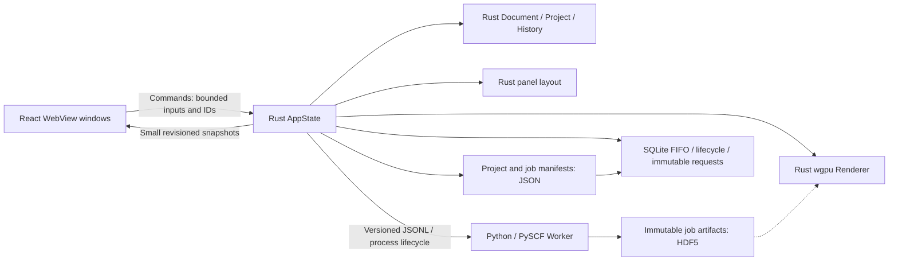

# ReactQM architecture

## Ownership



The scientific input, result, history, cancellation flag and revisions live in Rust. React holds an import draft and a read-only projection. The renderer owns a macOS native Metal surface, molecular meshes, camera and selection. Result/history docking and native utility windows share that state. Molecular rendering remains in the main viewport.

## Documents and scientific validation

`Document` schema v1 stores element numbers, coordinates explicitly in angstrom, charge, spin (`2S`), and a name. The XYZ importer accepts one basic XYZ frame, exact declared atom count and four fields per atom. Limits: 16 KiB input, 1–64 atoms, |coordinate| ≤ 10,000 Å, |charge| ≤ 64. It rejects nonfinite numbers, unknown elements, distances < 0.1 Å, nonpositive electron count, and inconsistent spin / electron parity. Extended XYZ and trajectory imports are not supported yet.

The document parser understands elements 1–118. The first **calculation** adapter deliberately accepts only H–Ne, spin 0, RHF/STO-3G. Basis coverage, other spin methods and broader element support need their own fixtures before expansion.

`Project` combines a document and optional calculation result. Result attachment/load validates the job UUID, input SHA-256, method, basis, convergence, finite energy and finite nonnegative runtime. The SHA-256 covers the serialized document, including its name. A mismatched result is rejected.

`Workspace` keeps up to 32 project snapshots for Undo / Redo. Importing a different molecule clears its calculation; Undo restores the previous molecule and its matching result. New edits clear the redo branch. History is session-only. Import, history, save and restore remain available while jobs run against their immutable queued inputs. Invalid imports leave the current project untouched.

## Rust / WebView boundary

- `AppState(Mutex<Workspace>)` is managed once by Tauri and outlives window projections.
- Commands: `layout_snapshot`, `update_layout`, `workspace_snapshot`, `set_locale`, `import_xyz`, `history_step`, `save_project`, `load_project`, `start_calculation`, `cancel_job`, `queue_snapshot`, `set_queue_paused`, `cancel_queued_job`, `list_jobs`, `restore_job`, `retry_job`, `update_viewport`, `detach_viewport`.
- `workspace-changed` carries a small snapshot: document metadata, job status and optional scalar result. It never contains atom arrays, gradients, volumes, orbital data or rendered frames.
- The only coordinate input from the UI is a bounded XYZ import command, not per-frame rendering traffic.
- A monotonic snapshot revision lets React reject stale responses/events. A separate document revision rejects commands based on a previous document.
- Computation, process polling and artifact hashing occur outside the document lock. Catalog list/restore/retry commands use blocking tasks. Small local project saves and starting/cancelling SQLite transitions are currently serialized under the document lock; these local transitions remain serialized while Worker execution is scheduled outside the lock. `CatalogState` owns the SQLite mutex and a lifetime workspace file lease separately from `Workspace`.
- The browser preview permits language switching only. It does not emulate successful calculations.

## Worker contract and lifecycle

Rust starts the configured Python executable directly, with argument arrays and no shell. The development default points to `worker/.venv`; `REACTQM_PYTHON` may override it. `PYTHONPATH` points to this checkout's Worker source. The desktop bundle does **not** yet contain a redistributable Python environment and is tied to the development checkout.

Rust writes a JSON request to stdin and closes it. The request contains schema version 1, job UUID, document revision, SHA-256, document/units, method, basis, maximum 50 SCF cycles and `conv_tol=1e-9`. The Worker independently validates its supported input. It sends versioned `progress`, `result` or `error` events on stdout; engine diagnostics go to stderr. Rust bounds each response line to 8 KiB and queues at most 16 messages. Worker requests are bounded to 32 KiB. Progress draining is bounded so excessive output cannot starve timeout/cancellation checks.

One application-owned scheduler executes a FIFO queue, one job at a time; additional submissions persist as queued immutable requests. Rust owns the cancellation flag and a 120-second execution timeout. On Unix the child gets its own process group, which is terminated and reaped on failure/cancellation. Windows currently only has direct-child termination and is unvalidated. Normal application exit stops future claims, persists queue pause/cancellation, signals the active job and joins the scheduler for child cleanup. This also runs in the final Exit callback because the native macOS Quit path can bypass ExitRequested. On the next startup, interrupted running/cancelling records are reconciled. A force-killed parent may leave an orphan Worker until it exits; late artifacts without an accepted completion receipt are not promoted to success. Orphan process cleanup and power-loss behavior need further platform validation.

Successful results require all of: matching job ID and input, valid schema, finite values, `converged=true`, and a successful process exit. Nonconvergence is an error, never a usable energy result. A cancelled/expired job cannot attach a late success. The current progress is SCF cycle count, not a predicted completion percentage.

## Units and interpretation

Document coordinates: Å. PySCF `kernel()` returns total clamped-nuclei energy in hartree, including nuclear repulsion, without ZPE or thermal corrections. The UI labels it total energy. Nuclear gradients are stored in hartree / bohr. Spin is `2S`; multiplicity is `2S + 1`.

Future ASE adapters must explicitly convert energy to eV and force to eV / Å, including the negative sign from gradient to force. SCF convergence alone does not prove a physically accurate ground-state energy or reaction barrier.

## Persistence

Default root: Tauri `app_data_dir()` (`~/Library/Application Support/dev.reactqm.desktop` on this macOS setup). `REACTQM_DATA_DIR` overrides it for isolated tests; use an absolute path.

```text
layout.json                   Panel membership/order/mode/active tabs/side width, schema v1
workspace.json                Explicitly saved project, schema v1
workspace.lock                Exclusive lifetime workspace lease
jobs.sqlite3                  Versioned SQLite v2 attempt / FIFO queue index (WAL / FULL synchronous)
jobs/<UUID>/input.json        Input, hash, revision, method and convergence settings
jobs/<UUID>/worker.log        Child stderr
jobs/<UUID>/scf.chk           PySCF checkpoint (not yet used for resume)
jobs/<UUID>/result.h5         Coordinates, total energy, gradients and unit attributes
jobs/<UUID>/result.json       Successful scalar result and engine version
jobs/<UUID>/status.json       Compatibility terminal-state manifest
jobs/<UUID>/completion.json   SHA-256 / byte lengths of input.json, result.json, result.h5
```

Project JSON is written to a unique temporary file, synced and atomically renamed. Saved project reads are capped at 128 KiB and revalidated before replacing live state. A damaged file leaves the current project unchanged. Save is explicit; after restart, Reload reads the last saved project. It is a single workspace slot, not a project browser.

Successful Worker artifacts are closed/synced and atomically renamed before the result event. `Catalog::enqueue` persists the immutable request and a `queued` SQLite row; `claim_next` uses an immediate transaction to check pause/active status and promote the oldest sequence to running before spawning a Worker. Waiting cancellation uses a conditional status update, so it cannot cancel an already claimed job or a different job. Each UUID has a separate directory. The index stores input/settings, display metadata, timestamps, status, errors, scalar energy, retry ancestry and the completion receipt hash. Floating-point JSON round trips are enabled so persisted coordinates preserve input identity.

After validated success and successful child exit, Rust checks the on-disk result against the accepted result, checks the HDF5 signature, streams SHA-256 / sizes of the three fixed artifacts, and atomically writes a versioned completion receipt. It then commits `succeeded` and the receipt hash to SQLite. The compatibility status JSON is best effort after this commit. Normal restores verify the receipt against its SQLite digest, all artifact digests/sizes, the exact saved request, document fingerprint and matching converged scalar result **before** changing the document. Failure marks that history row `corrupt` and leaves the current project intact. JSON reads are capped at 128 KiB, individual artifact hashes at 64 MiB; UUID paths and regular-file requirements are enforced. HDF5 arrays are not reopened or transferred to the UI in this milestone.

Cancellation first persists `cancelling`; success can commit only while the row is `running`. Thus a late result cannot override an accepted cancellation. Startup resolves `cancelling` as cancelled; a `running` row becomes succeeded only if a valid completion receipt exists, otherwise interrupted. A completed receipt can recover the crash gap before the SQLite success commit. Bare result JSON/HDF5 files alone do not authorize success. Persisting failures happens before writing their compatibility JSON. A storage failure is surfaced rather than replaced with an in-memory success.

`Catalog` holds an exclusive `File::try_lock` lease for the workspace lifetime, preventing a second cooperating app instance from rewriting lifecycle state. Unsupported DB versions or storage failures disable new calculation/save operations and surface an error; no destructive DB reset occurs. Startup imports existing valid UUID job folders once per new index. Legacy successful status manifests without receipts establish a new, explicitly labeled baseline at import time. Existing receipts are always checked and retained rather than replaced with fresh hashes; cancelled/failed manifests are never upgraded just because result files exist. Invalid legacy folders remain untouched and unindexed. This is integrity checking against local records, not a claim of historical numerical validation for legacy artifacts.

History and FIFO queue IPC are paginated (20 scalar metadata rows each). The queue has a 100-waiting-job bound. Schema v2 adds a status/sequence index and durable pause metadata while retaining v1 records. Every application start pauses the queue explicitly, preserving pending UUIDs/order and reconciling only previously running/cancelling rows. `job-history-changed` refreshes the read-only projections; `queue-error` exposes scheduler/storage errors.

`Scheduler` owns a gate, condition variable and one joined thread. The gate serializes claim with pause/shutdown, while SQLite serializes claim against queued cancellation. Enqueue/pause use the gate before the workspace lock; blocking Worker work and artifact hashing hold neither lock. The executor continues after a normal job failure/cancellation, and pauses after completion/storage errors. Invalid queued input files are rejected before Worker launch, leaving subsequent valid jobs runnable. Shutdown blocks new claims before cancelling the active child and joining the thread; pending work is preserved. Force-killed parents cannot run cleanup, so orphan-process recovery remains a platform validation item.

Restore is revision-checked and participates in Undo. Retry reads the saved request, preserves method/basis/SCF settings, creates a new UUID with `retry_of`, and queues it without replacing the displayed molecule. A session-local `Workspace.result_targets` map allows completion to update the current result only if its exact input and document revision are unchanged. Edits, undo/restore and jobs from previous app sessions cannot overwrite the current document. Every successful job remains available through verified history restore. Checkpoint continuation, HDF5 semantic revalidation, priority/reordering and automatic DB repair/backup remain future work.

## Panel layout and native utility windows

`Workspace.layout` owns a versioned arrangement of exactly two utility panels: result and history. Each panel appears once, either in the right/bottom dock or in its own native window. The molecule stays in `main`; no second renderer is created. Independent floating windows read the same revisioned workspace, queue and history and issue the same document commands. Import drafts and local UI loading/error state are per projection; documents, Undo and jobs are shared.

`layout_snapshot` / `layout-changed` carry the small layout plus a startup/recovery error. `update_layout(expected_revision, action)` supports move/reorder, active tab, tab/split mode, bounded 25–60% side width, and reset. An application-owned asynchronous gate serializes changes and native close/restore. Stale revisions are rejected and refreshed. Native window construction does not hold the document mutex and runs from an async command/task, following the [Tauri window-creation guidance](https://docs.rs/tauri/latest/tauri/webview/struct.WebviewWindowBuilder.html). Window labels are a fixed allowlist (`panel-result`, `panel-history`), with event subscription capabilities only; JavaScript has no general window-creation or filesystem permissions.

Layout saves use atomic JSON replacement under the catalog's lifetime workspace lease. Reads are capped at 8 KiB and reject duplicate/missing panels, unsupported versions and invalid widths. Invalid saved layouts are preserved until an explicit reset; the fallback UI remains usable. Native window creation failure leaves the previous arrangement intact. A floating window's close request redocks to its remembered home; redock/reset destroys the utility projection. Main-window close exits the application, including floating projections and scheduler cleanup. App quit preserves floating membership for next startup. Floating geometry is currently a centered 480×640 logical window with minimum 360×320; positions/size restoration and multi-monitor recovery remain future work.

The React dock adapts to narrow windows by stacking without changing the authoritative arrangement. Drag/drop changes only panel IDs and destination/order. Buttons provide the same actions without dragging; tabs and a focusable divider support keyboard use. Only one view per panel is mounted. Geometry-only drag feedback and resize previews stay local; the committed arrangement is Rust-owned and saved. Floating windows never mount `MoleculeViewport`.

## Native molecular rendering

`Workspace.renderer` owns one viewport for the `main` window. `update_viewport` accepts a client ID, bounded viewport rectangle, document revision and up to 128 small actions (orbit, zoom, fit, pick, select-next, toggle bonds). It derives the scene from the authoritative Rust document; no atom list or frames cross this IPC boundary. Its response contains readiness, frame count, pixel size, inferred bond count and at most one selected atom's index/symbol/coordinates. These are view diagnostics, not scientific results.

On macOS, `with_webview` attaches a retained `CAMetalLayer` to the WKWebView's backing layer through a transparent clipping layer. Native layers and surface operations stay on the main thread; `MainThreadBound` retains the attachment, with surface destruction preceding layer removal. CALayers do not intercept input: React's reserved rectangle receives pointer and keyboard events. Native content sits above HTML within that rectangle, so controls and tooltips are placed outside it. The fixed command/queue header and its popovers report a top occlusion boundary. Metal starts below that boundary, even during scrolling or wrapped toolbar layouts. Title/sharing-bar insets are derived from the native bounds and browser viewport, not a hard-coded height.

Resize/scroll/visibility/theme and native focus/scale events schedule demand-driven frames. JS coalesces orbit/zoom input and allows only one request in flight. The Rust camera stays independent of WebView render state. Client-specific detach prevents an old React mount from destroying a newer attachment. Document revision changes rebuild the scene, fit the camera and clear selection; actions based on an old document are ignored. View state does not change the scientific document/hash or Undo history.

The visible DOM intersection determines the Metal surface size. A cropped projection retains the full viewport camera and perspective, so partial scrolling does not move or stretch the molecule. Pixel resolution uses native backing scale and CSS-point scale, capped at 4096 per dimension and the GPU limit. Hidden/zero-sized regions do not acquire a drawable. Surface loss/outdating triggers reconfiguration; a device-loss recovery service remains future work. This implementation is single-window; other platforms return an explicit unsupported error.

The GPU uses instanced sphere/cylinder meshes, element colors, perspective lighting, a Depth32Float buffer and 4× MSAA when supported. Rust ray/sphere picking returns the nearest intersected atom; a selected atom is orange. Camera zoom/pitch are bounded. Geometry, instance data and rendered images remain in Rust/GPU memory. The CPU test/probe readback path is separate from application IPC.

XYZ has no bonds. Display-only hints use `distance <= 1.2 * (r_cov_a + r_cov_b)` and exclude noble gases. The covalent-radius table is exported from RDKit 2026.09.1; atom drawing radii are illustrative. No bond order/valence inference is written into Document. These hints must not be treated as reaction connectivity or validated chemical bonds.

Confirmed on Apple M4 / Metal at 1×: H₂/H₂O, orbit, zoom, fit, pointer/keyboard selection, bond toggle, native resize, clipping, save/load/history synchronization and native app close/reopen. Retina, mixed-scale monitor moves, native dark composition, multiple native surfaces and Windows/Linux remain pending. GPU dark output and browser dark layout were tested separately.

## Verification

- Rust unit tests: molecular bond hints, camera fitting, nearest-atom picking, mesh winding, XYZ parsing, schema/units, electron/spin validation, overlap checks, history branching, save/reload, result identity and nonconvergence rejection.
- Rust process tests: controlled child exit, malformed/oversized output, foreign job IDs, nonconvergence, silent timeout, output-flood timeout, cancellation and child reaping.
- `render_probe`: real GPU images for water, cropped view, selection, rotation/dark and portrait; foreground/element/selection checks and pixel comparison of the crop against the full frame. PNG output is local Rust-only readback.
- `queue_probe`: persisted FIFO across reopen, queued cancellation without spawning a Worker, two actual H₂ calculations, single-claim exclusion and continuation after a controlled Worker failure.
- Queue tests also race claim/cancel, test concurrent claimers, pause/resume, queue bounds/pagination, damaged waiting inputs and abrupt process exit with pending work.
- `catalog_probe`: actual H₂/PySCF artifacts → SQLite → reopen → verified restore → repeat attempt → corrupt one HDF5 and confirm isolation.
- Catalog tests also cover abrupt separate-process exit, cancellation/completion ordering, old-format import, preserved checksum baselines during reindexing, pagination and exclusive leases. Synthetic storage fixtures test bookkeeping only.
- `calculation_probe`: real Rust → Worker → PySCF H₂ RHF/STO-3G energy/gradient, HDF5 existence, project/result save/load.
- Python tests: independent request validation, real energy/gradient artifacts and units, no success artifact on nonconvergence, original installation smoke.
- Native UI: H₂ calculation, save/load, invalid coordinates, molecule replacement, matching result restoration with Undo/Redo, cancellation.
- Chrome preview: Japanese/English/Simplified Chinese, widths 320/375/1100, light/dark, keyboard tooltip, no overflow or app console errors. This does not substitute for native execution tests.

## Remote execution: later

No server is required at this stage. If operations justify XServer, keep App VPS + Managed PostgreSQL + NFS in the Cloud core and communicate with separate VPS Workers through authenticated HTTPS / a queue. Do not depend on Workers directly accessing the managed database. NVIDIA GPU execution, signed distribution and native Windows/Linux validation remain environment-dependent items.

## Official references

- [Tauri prerequisites](https://v2.tauri.app/start/prerequisites/)
- [PySCF SCF methods and convergence](https://pyscf.org/user/scf)
- [PySCF SCF callback API](https://pyscf.org/pyscf_api_docs/pyscf.scf.html)
- [wgpu Instance API](https://wgpu.rs/doc/wgpu/struct.Instance.html)
- [Apple CAMetalLayer drawableSize](https://developer.apple.com/documentation/quartzcore/cametallayer/drawablesize)
- [rusqlite 0.37 API](https://docs.rs/rusqlite/0.37.0/rusqlite/)
- [Rust workspace file locks](https://doc.rust-lang.org/std/fs/struct.File.html#method.try_lock)
- [RDKit PeriodicTable / covalent radii](https://rdkit.org/new_docs/source/rdkit.Chem.PeriodicTable.html)

Exact dependencies are recorded in `package-lock.json`, `src-tauri/Cargo.lock`, and `worker/uv.lock`.
