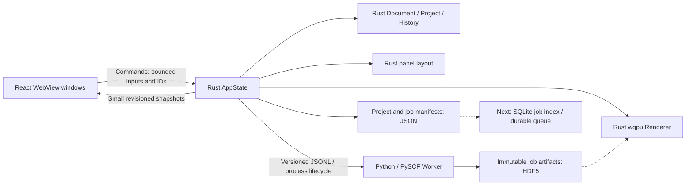

# ReactQM architecture

## Ownership



The scientific input, result, history, cancellation flag and revisions live in Rust. React holds an import draft and a read-only projection. The renderer owns a macOS native Metal surface, molecular meshes, camera and selection. Docking and multiple viewports remain unimplemented.

## Documents and scientific validation

`Document` schema v1 stores element numbers, coordinates explicitly in angstrom, charge, spin (`2S`), and a name. The XYZ importer accepts one basic XYZ frame, exact declared atom count and four fields per atom. Limits: 16 KiB input, 1–64 atoms, |coordinate| ≤ 10,000 Å, |charge| ≤ 64. It rejects nonfinite numbers, unknown elements, distances < 0.1 Å, nonpositive electron count, and inconsistent spin / electron parity. Extended XYZ and trajectory imports are not supported yet.

The document parser understands elements 1–118. The first **calculation** adapter deliberately accepts only H–Ne, spin 0, RHF/STO-3G. Basis coverage, other spin methods and broader element support need their own fixtures before expansion.

`Project` combines a document and optional calculation result. Result attachment/load validates the job UUID, input SHA-256, method, basis, convergence, finite energy and finite nonnegative runtime. The SHA-256 covers the serialized document, including its name. A mismatched result is rejected.

`Workspace` keeps up to 32 project snapshots for Undo / Redo. Importing a different molecule clears its calculation; Undo restores the previous molecule and its matching result. New edits clear the redo branch. History is session-only. Import, history, save and load are blocked while a job runs. Invalid imports leave the current project untouched.

## Rust / WebView boundary

- `AppState(Mutex<Workspace>)` is managed once by Tauri and outlives window projections.
- Commands: `workspace_snapshot`, `set_locale`, `import_xyz`, `history_step`, `save_project`, `load_project`, `start_calculation`, `cancel_job`, `update_viewport`, `detach_viewport`.
- `workspace-changed` carries a small snapshot: document metadata, job status and optional scalar result. It never contains atom arrays, gradients, volumes, orbital data or rendered frames.
- The only coordinate input from the UI is a bounded XYZ import command, not per-frame rendering traffic.
- A monotonic snapshot revision lets React reject stale responses/events. A separate document revision rejects commands based on a previous document.
- All computation and child-process polling occurs outside the state lock. Small local project saves and terminal manifest writes are currently serialized under the lock; move those behind a persistence service if storage becomes slow or remote.
- The browser preview permits language switching only. It does not emulate successful calculations.

## Worker contract and lifecycle

Rust starts the configured Python executable directly, with argument arrays and no shell. The development default points to `worker/.venv`; `REACTQM_PYTHON` may override it. `PYTHONPATH` points to this checkout's Worker source. The desktop bundle does **not** yet contain a redistributable Python environment and is tied to the development checkout.

Rust writes a JSON request to stdin and closes it. The request contains schema version 1, job UUID, document revision, SHA-256, document/units, method, basis, maximum 50 SCF cycles and `conv_tol=1e-9`. The Worker independently validates its supported input. It sends versioned `progress`, `result` or `error` events on stdout; engine diagnostics go to stderr. Rust bounds each response line to 8 KiB and queues at most 16 messages. Worker requests are bounded to 32 KiB. Progress draining is bounded so excessive output cannot starve timeout/cancellation checks.

One job runs at a time; a second start is rejected. Rust owns the cancellation flag and a 120-second execution timeout. On Unix the child gets its own process group, which is terminated and reaped on failure/cancellation. Windows currently only has direct-child termination and is unvalidated. Normal application exit during a job requests cancellation and waits for cleanup before exiting; force-killed parent/crash recovery is not implemented yet.

Successful results require all of: matching job ID and input, valid schema, finite values, `converged=true`, and a successful process exit. Nonconvergence is an error, never a usable energy result. A cancelled/expired job cannot attach a late success. The current progress is SCF cycle count, not a predicted completion percentage.

## Units and interpretation

Document coordinates: Å. PySCF `kernel()` returns total clamped-nuclei energy in hartree, including nuclear repulsion, without ZPE or thermal corrections. The UI labels it total energy. Nuclear gradients are stored in hartree / bohr. Spin is `2S`; multiplicity is `2S + 1`.

Future ASE adapters must explicitly convert energy to eV and force to eV / Å, including the negative sign from gradient to force. SCF convergence alone does not prove a physically accurate ground-state energy or reaction barrier.

## Persistence

Default root: Tauri `app_data_dir()` (`~/Library/Application Support/dev.reactqm.desktop` on this macOS setup). `REACTQM_DATA_DIR` overrides it for isolated tests; use an absolute path.

```text
workspace.json                Explicitly saved project, schema v1
jobs/<UUID>/input.json        Input, hash, revision, method and convergence settings
jobs/<UUID>/worker.log        Child stderr
jobs/<UUID>/scf.chk           PySCF checkpoint (not yet used for resume)
jobs/<UUID>/result.h5         Coordinates, total energy, gradients and unit attributes
jobs/<UUID>/result.json       Successful scalar result and engine version
jobs/<UUID>/status.json       Terminal UI job state
```

Project JSON is written to a unique temporary file, synced and atomically renamed. Saved project reads are capped at 128 KiB and revalidated before replacing live state. A damaged file leaves the current project unchanged. Save is explicit; after restart, Reload reads the last saved project. It is a single workspace slot, not a project browser.

Successful Worker artifacts are closed/synced and atomically renamed before the final result event. Cancelled jobs may leave checkpoints or temporary files; those files are never treated as completed results. The current UI shows the latest job only. Durable queued/running states, crash recovery, checksums for artifact contents, historical browsing and SQLite indexing remain next steps. A project reload restores the saved scalar result; it does not yet validate/reopen its HDF5 arrays.

## Native molecular rendering

`Workspace.renderer` owns one viewport for the `main` window. `update_viewport` accepts a client ID, bounded viewport rectangle, document revision and up to 128 small actions (orbit, zoom, fit, pick, select-next, toggle bonds). It derives the scene from the authoritative Rust document; no atom list or frames cross this IPC boundary. Its response contains readiness, frame count, pixel size, inferred bond count and at most one selected atom's index/symbol/coordinates. These are view diagnostics, not scientific results.

On macOS, `with_webview` attaches a retained `CAMetalLayer` to the WKWebView's backing layer through a transparent clipping layer. Native layers and surface operations stay on the main thread; `MainThreadBound` retains the attachment, with surface destruction preceding layer removal. CALayers do not intercept input: React's reserved rectangle receives pointer and keyboard events. Native content sits above HTML within that rectangle, so controls and tooltips are placed outside it. Title/sharing-bar insets are derived from the native bounds and browser viewport, not a hard-coded height.

Resize/scroll/visibility/theme and native focus/scale events schedule demand-driven frames. JS coalesces orbit/zoom input and allows only one request in flight. The Rust camera stays independent of WebView render state. Client-specific detach prevents an old React mount from destroying a newer attachment. Document revision changes rebuild the scene, fit the camera and clear selection; actions based on an old document are ignored. View state does not change the scientific document/hash or Undo history.

The visible DOM intersection determines the Metal surface size. A cropped projection retains the full viewport camera and perspective, so partial scrolling does not move or stretch the molecule. Pixel resolution uses native backing scale and CSS-point scale, capped at 4096 per dimension and the GPU limit. Hidden/zero-sized regions do not acquire a drawable. Surface loss/outdating triggers reconfiguration; a device-loss recovery service remains future work. This implementation is single-window; other platforms return an explicit unsupported error.

The GPU uses instanced sphere/cylinder meshes, element colors, perspective lighting, a Depth32Float buffer and 4× MSAA when supported. Rust ray/sphere picking returns the nearest intersected atom; a selected atom is orange. Camera zoom/pitch are bounded. Geometry, instance data and rendered images remain in Rust/GPU memory. The CPU test/probe readback path is separate from application IPC.

XYZ has no bonds. Display-only hints use `distance <= 1.2 * (r_cov_a + r_cov_b)` and exclude noble gases. The covalent-radius table is exported from RDKit 2026.09.1; atom drawing radii are illustrative. No bond order/valence inference is written into Document. These hints must not be treated as reaction connectivity or validated chemical bonds.

Confirmed on Apple M4 / Metal at 1×: H₂/H₂O, orbit, zoom, fit, pointer/keyboard selection, bond toggle, native resize, clipping, save/load/history synchronization and native app close/reopen. Retina, mixed-scale monitor moves, native dark composition, multiple native surfaces and Windows/Linux remain pending. GPU dark output and browser dark layout were tested separately.

## Verification

- Rust unit tests: molecular bond hints, camera fitting, nearest-atom picking, mesh winding, XYZ parsing, schema/units, electron/spin validation, overlap checks, history branching, save/reload, result identity and nonconvergence rejection.
- Rust process tests: controlled child exit, malformed/oversized output, foreign job IDs, nonconvergence, silent timeout, output-flood timeout, cancellation and child reaping.
- `render_probe`: real GPU images for water, cropped view, selection, rotation/dark and portrait; foreground/element/selection checks and pixel comparison of the crop against the full frame. PNG output is local Rust-only readback.
- `calculation_probe`: real Rust → Worker → PySCF H₂ RHF/STO-3G energy/gradient, HDF5 existence, project/result save/load.
- Python tests: independent request validation, real energy/gradient artifacts and units, no success artifact on nonconvergence, original installation smoke.
- Native UI: H₂ calculation, save/load, invalid coordinates, molecule replacement, matching result restoration with Undo/Redo, cancellation.
- Chrome preview: Japanese/English/Simplified Chinese, widths 320/375/1100, light/dark, keyboard tooltip, no overflow or app console errors. This does not substitute for native execution tests.

## Remote execution: later

No server is required at this stage. If operations justify XServer, keep App VPS + Managed PostgreSQL + NFS in the Cloud core and communicate with separate VPS Workers through authenticated HTTPS / a queue. Do not depend on Workers directly accessing the managed database. NVIDIA GPU execution, signed distribution and native Windows/Linux validation remain environment-dependent items.

## Official references

- [Tauri prerequisites](https://v2.tauri.app/start/prerequisites/)
- [PySCF SCF methods and convergence](https://pyscf.org/user/scf)
- [PySCF SCF callback API](https://pyscf.org/pyscf_api_docs/pyscf.scf.html)
- [wgpu Instance API](https://wgpu.rs/doc/wgpu/struct.Instance.html)
- [Apple CAMetalLayer drawableSize](https://developer.apple.com/documentation/quartzcore/cametallayer/drawablesize)
- [RDKit PeriodicTable / covalent radii](https://rdkit.org/new_docs/source/rdkit.Chem.PeriodicTable.html)

Exact dependencies are recorded in `package-lock.json`, `src-tauri/Cargo.lock`, and `worker/uv.lock`.
