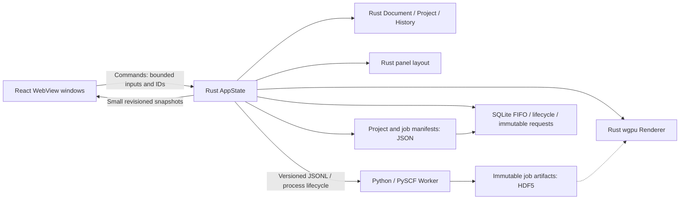

# ReactQM architecture

## Ownership



The scientific input, result, history, cancellation flag and revisions live in Rust. React holds an import draft and a read-only projection. The renderer owns a macOS native Metal surface, molecular meshes, camera and selection. Result/history docking and native utility windows share that state. Molecular rendering remains in the main viewport.

## Documents and scientific validation

`Document` schema v1 stores element numbers, coordinates explicitly in angstrom, charge, spin (`2S`), and a name. The XYZ importer accepts one basic XYZ frame, exact declared atom count and four fields per atom. Limits: 16 KiB input, 1–64 atoms, |coordinate| ≤ 10,000 Å, |charge| ≤ 64. It rejects nonfinite numbers, unknown elements, distances < 0.1 Å, nonpositive electron count, and inconsistent spin / electron parity. Extended XYZ and trajectory imports are not supported yet.

The document parser understands elements 1–118. The calculation adapters accept H–Ne, spin 0: RHF and RKS (PBE/PBE0/B3LYP), with sto-3g/6-31g/def2-svp. Open-shell methods and broader element support require separate fixtures.

`Project` combines a document and optional calculation result. Result attachment/load validates the job UUID, input SHA-256, method, basis, convergence, finite energy and finite nonnegative runtime. The SHA-256 covers the serialized document, including its name. A mismatched result is rejected.

`Workspace` keeps up to 32 project snapshots for Undo / Redo. Importing a different molecule clears its calculation; Undo restores the previous molecule and its matching result. New edits clear the redo branch. History is session-only. Import, history, save and restore remain available while jobs run against their immutable queued inputs. Invalid imports leave the current project untouched.

## Rust / WebView boundary

- `AppState(Mutex<Workspace>)` is managed once by Tauri and outlives window projections.
- Commands: `layout_snapshot`, `update_layout`, `workspace_snapshot`, `set_locale`, `import_xyz`, `history_step`, `save_project`, `load_project`, `start_calculation`, `cancel_job`, `queue_snapshot`, `set_queue_paused`, `cancel_queued_job`, `list_jobs`, `restore_job`, `retry_job`, `update_viewport`, `detach_viewport`.
- `workspace-changed` carries a small snapshot: document metadata, job status and optional scalar result. It never contains atom arrays, gradients, volumes, orbital data or rendered frames.
- The only coordinate input from the UI is a bounded XYZ import command, not per-frame rendering traffic.
- A monotonic snapshot revision lets React reject stale responses/events. A separate document revision rejects commands based on a previous document.
- Computation, process polling and artifact hashing occur outside the document lock. Catalog list/restore/retry commands use blocking tasks. Small local project saves and starting/cancelling SQLite transitions are currently serialized under the document lock; these local transitions remain serialized while Worker execution is scheduled outside the lock. `CatalogState` owns the SQLite mutex and a lifetime workspace file lease separately from `Workspace`.
- The browser preview permits language switching only. It does not emulate successful calculations.

## Worker contract and lifecycle

Rust starts the configured Python executable directly, with argument arrays and no shell. The development default points to `worker/.venv`; `REACTQM_PYTHON` may override it. `PYTHONPATH` points to this checkout's Worker source. The desktop bundle does **not** yet contain a redistributable Python environment and is tied to the development checkout.

Rust writes a JSON request to stdin and closes it. The request contains schema version 1, job UUID, document revision, SHA-256, document/units, method, basis, 1–50 SCF cycles and energy tolerance 1e-12–1e-6 (default 1e-9), plus the bounded settings envelope for new jobs. The Worker independently validates its supported input. It sends versioned `progress`, `result` or `error` events on stdout; engine diagnostics go to stderr. Rust bounds each response line to 8 KiB and queues at most 16 messages. The Worker bounds request lines to 64 KiB, including structure provenance. Progress draining is bounded so excessive output cannot starve timeout/cancellation checks.

One application-owned scheduler executes a FIFO queue, one job at a time; additional submissions persist as queued immutable requests. Rust owns the cancellation flag and a 120-second execution timeout. On Unix the child gets its own process group, which is terminated and reaped on failure/cancellation. Windows currently only has direct-child termination and is unvalidated. Normal application exit stops future claims, persists queue pause/cancellation, signals the active job and joins the scheduler for child cleanup. This also runs in the final Exit callback because the native macOS Quit path can bypass ExitRequested. On the next startup, interrupted running/cancelling records are reconciled. A force-killed parent may leave an orphan Worker until it exits; late artifacts without an accepted completion receipt are not promoted to success. Orphan process cleanup and power-loss behavior need further platform validation.

Successful results require all of: matching job ID and input, valid schema, finite values, `converged=true`, and a successful process exit. Nonconvergence is an error, never a usable energy result. A cancelled/expired job cannot attach a late success. The current progress is SCF cycle count, not a predicted completion percentage.

## Molecule editor

The edit_molecule command checks the document revision and validates the complete candidate before replacing the shared Project. Each accepted edit creates one Undo entry. The viewport sends normalized drag endpoints, and Rust resolves the picked atom and unprojects the displacement at its depth. Editing invalidates the attached calculation and import provenance. Existing queued inputs retain their original document.

The optional Document bond list is sorted and validated for unique atom pairs and integer orders 1–3. An absent list keeps automatic perception and an explicit empty list renders zero bonds. The first bond edit copies the displayed Rust graph. Manual bonds survive project save, restoration and optimization, and renderer analysis cannot overwrite them. IPC returns just the selected atom's incident bonds.

## Units and interpretation

Document coordinates: Å. PySCF `kernel()` returns total clamped-nuclei energy in hartree, including nuclear repulsion, without ZPE or thermal corrections. The UI labels it total energy. Nuclear gradients are stored in hartree / bohr. Spin is `2S`; multiplicity is `2S + 1`.

Future ASE adapters must explicitly convert energy to eV and force to eV / Å, including the negative sign from gradient to force. SCF convergence alone does not prove a physically accurate ground-state energy or reaction barrier.

## Persistence

Default root: Tauri `app_data_dir()` (`~/Library/Application Support/dev.reactqm.desktop` on this macOS setup). `REACTQM_DATA_DIR` overrides it for isolated tests; use an absolute path.

```text
layout.json                   Panel membership/order/mode/active tabs/side width, schema v1
workspace.json                Explicitly saved project and next settings, schema v2 (reads v1)
workspace.lock                Exclusive lifetime workspace lease
jobs.sqlite3                  Versioned SQLite v2 attempt / FIFO queue index (WAL / FULL synchronous)
jobs/<UUID>/input.json        Input, hash, revision, method and convergence settings
jobs/<UUID>/worker.log        Child stderr
jobs/<UUID>/scf.chk           PySCF checkpoint (not yet used for resume)
jobs/<UUID>/result.h5         Coordinates, total energy, gradients and unit attributes
jobs/<UUID>/result.json       Successful scalar result and engine version
jobs/<UUID>/status.json       Compatibility terminal-state manifest
jobs/<UUID>/completion.json   SHA-256 / byte lengths of input.json, result.json, result.h5
```

Project JSON is written to a unique temporary file, synced and atomically renamed. Saved project reads are capped at 128 KiB and revalidated before replacing live state. A damaged file leaves the current project unchanged. Save is explicit; after restart, Reload reads the last saved project. It is a single workspace slot, not a project browser.

Successful Worker artifacts are closed/synced and atomically renamed before the result event. `Catalog::enqueue` persists the immutable request and a `queued` SQLite row; `claim_next` uses an immediate transaction to check pause/active status and promote the oldest sequence to running before spawning a Worker. Waiting cancellation uses a conditional status update, so it cannot cancel an already claimed job or a different job. Each UUID has a separate directory. The index stores input/settings, display metadata, timestamps, status, errors, scalar energy, retry ancestry and the completion receipt hash. Floating-point JSON round trips are enabled so persisted coordinates preserve input identity.

After validated success and successful child exit, Rust checks the on-disk result against the accepted result, checks the HDF5 signature, streams SHA-256 / sizes of the three fixed artifacts, and atomically writes a versioned completion receipt. It then commits `succeeded` and the receipt hash to SQLite. The compatibility status JSON is best effort after this commit. Normal restores verify the receipt against its SQLite digest, all artifact digests/sizes, the exact saved request, document fingerprint and matching converged scalar result **before** changing the document. Failure marks that history row `corrupt` and leaves the current project intact. JSON reads are capped at 128 KiB, individual artifact hashes at 64 MiB; UUID paths and regular-file requirements are enforced. HDF5 arrays are not reopened or transferred to the UI in this milestone.

Cancellation first persists `cancelling`; success can commit only while the row is `running`. Thus a late result cannot override an accepted cancellation. Startup resolves `cancelling` as cancelled; a `running` row becomes succeeded only if a valid completion receipt exists, otherwise interrupted. A completed receipt can recover the crash gap before the SQLite success commit. Bare result JSON/HDF5 files alone do not authorize success. Persisting failures happens before writing their compatibility JSON. A storage failure is surfaced rather than replaced with an in-memory success.

`Catalog` holds an exclusive `File::try_lock` lease for the workspace lifetime, preventing a second cooperating app instance from rewriting lifecycle state. Unsupported DB versions or storage failures disable new calculation/save operations and surface an error; no destructive DB reset occurs. Startup imports existing valid UUID job folders once per new index. Legacy successful status manifests without receipts establish a new, explicitly labeled baseline at import time. Existing receipts are always checked and retained rather than replaced with fresh hashes; cancelled/failed manifests are never upgraded just because result files exist. Invalid legacy folders remain untouched and unindexed. This is integrity checking against local records, not a claim of historical numerical validation for legacy artifacts.

History and FIFO queue IPC are paginated (20 scalar metadata rows each). The queue has a 100-waiting-job bound. Schema v2 adds a status/sequence index and durable pause metadata while retaining v1 records. Every application start pauses the queue explicitly, preserving pending UUIDs/order and reconciling only previously running/cancelling rows. `job-history-changed` refreshes the read-only projections; `queue-error` exposes scheduler/storage errors.

`Scheduler` owns a gate, condition variable and one joined thread. The gate serializes claim with pause/shutdown, while SQLite serializes claim against queued cancellation. Enqueue/pause use the gate before the workspace lock; blocking Worker work and artifact hashing hold neither lock. The executor continues after a normal job failure/cancellation, and pauses after completion/storage errors. Invalid queued input files are rejected before Worker launch, leaving subsequent valid jobs runnable. Shutdown blocks new claims before cancelling the active child and joining the thread; pending work is preserved. Force-killed parents cannot run cleanup, so orphan-process recovery remains a platform validation item.

Restore is revision-checked and participates in Undo. Retry reads the saved request, preserves method/basis/SCF settings, creates a new UUID with `retry_of`, and queues it without replacing the displayed molecule. A session-local `Workspace.result_targets` map allows completion to update the current result only if its exact input and document revision are unchanged. Edits, undo/restore and jobs from previous app sessions cannot overwrite the current document. Every successful job remains available through verified history restore. Checkpoint continuation, HDF5 semantic revalidation, priority/reordering and automatic DB repair/backup remain future work.

## Panel layout and native utility windows

Rust creates the main window with `WebviewWindowBuilder::from_config` during setup, after initializing shared state. The main window entry in `tauri.conf.json` supplies its settings with automatic creation disabled. The main window and each floating panel are top-level `WebviewWindow` instances with no native parent.

`Workspace.layout` owns a versioned arrangement of exactly two utility panels: result and history. Each panel appears once, either in the right/bottom dock or in its own native window. The molecule stays in `main`; no second renderer is created. Independent floating windows read the same revisioned workspace, queue and history and issue the same document commands. Import drafts and local UI loading/error state are per projection; documents, Undo and jobs are shared.

`layout_snapshot` / `layout-changed` carry the small layout plus a startup/recovery error. `update_layout(expected_revision, action)` supports move/reorder, active tab, tab/split mode, bounded 25–60% side width, and reset. An application-owned asynchronous gate serializes changes and native close/restore. Stale revisions are rejected and refreshed. Native window construction does not hold the document mutex and runs from an async command/task, following the [Tauri window-creation guidance](https://docs.rs/tauri/latest/tauri/webview/struct.WebviewWindowBuilder.html). Window labels are a fixed allowlist (`panel-result`, `panel-history`), with event subscription capabilities only; JavaScript has no general window-creation or filesystem permissions.

Layout saves use atomic JSON replacement under the catalog's lifetime workspace lease. Reads are capped at 8 KiB and reject duplicate/missing panels, unsupported versions and invalid widths. Invalid saved layouts are preserved until an explicit reset; the fallback UI remains usable. Native window creation failure leaves the previous arrangement intact. A floating window's close request redocks to its remembered home; redock/reset destroys the utility projection. Main-window close exits the application, including floating projections and scheduler cleanup. App quit preserves floating membership for next startup. Floating windows default to a centered 480×640 logical client area (minimum 360×320). Rust `GeometryService` stores their physical desktop positions and DPI-independent client sizes in a separate bounded, schema-versioned `panel-geometry.json`. Geometry does not increment dock-layout/document revisions. Native move/resize/scale events update Rust memory; a single background writer coalesces changes after 350 ms of inactivity. Redocking/closing and shutdown flush pending writes under the same geometry mutex, using the catalog lifetime lease and atomic JSON replacement. Hidden, minimized, maximized and fullscreen bounds do not overwrite normal geometry.

Creation restores geometry before showing a panel. Restoration and explicit panel activation fit the saved title-bar position and logical client size into the nearest currently available monitor work area, reserving decoration space; negative monitor origins and scale factors are handled in Rust. Activation also unminimizes the window. Corrupt/unsupported/oversized geometry files are preserved and reported through the existing layout recovery UI until explicit layout reset clears geometry. Existing layout schema v1 remains compatible. A native single-monitor probe verifies persistence, disk reload, recreation, offscreen recovery and reset; actual mixed-DPI multi-monitor moves, hot unplug and visual/keyboard interaction remain pending.

The React dock adapts to narrow windows by stacking without changing the authoritative arrangement. Drag/drop changes only panel IDs and destination/order. Buttons provide the same actions without dragging; tabs and a focusable divider support keyboard use. Only one view per panel is mounted. Geometry-only drag feedback and resize previews stay local; the committed arrangement is Rust-owned and saved. Floating windows never mount `MoleculeViewport`.

Panel-title-scoped Alt+Right/Down/Up issues the same Rust move action as the icon buttons; Alt+Shift+Left/Right uses the existing before-panel insertion contract. Rust chooses the destination native window for move/activate/redock/reset, restores native focus, and emits `panel-focus { panel, revision }` only to that window using `emit_to`. This is a transient UI intent, not document state. The receiving projection retains an early intent until its layout revision is available and its pending command has completed, then focuses the matching tab or utility heading. Older focus intents cannot overwrite newer ones. A newly created utility heading focuses only after the initial authoritative floating membership arrives. Focus scrolling accounts for the current sticky toolbar bounds. Command failures restore a still-connected source control when focus fell back to the body; an immediate in-flight guard prevents duplicate IPC before React commits the disabled state.

Validation separates a Chrome UI-only IPC fixture (keyboard, actual pointer drag, out-of-order focus/layout events, storage failure, 18 locale/width/theme combinations) from native macOS keyboard/window checks. Native initial heading focus, keyboard moves/reordering/redock, close-to-redock focus, minimized reactivation and sticky-header visibility were observed. The CUA native pointer drag did not produce a verified layout change; it remains pending rather than inheriting the Chrome result.

## Native molecular rendering

`Workspace.renderer` owns one viewport for the `main` window. `update_viewport` accepts a client ID, bounded viewport rectangle, document revision and up to 128 small actions (orbit, zoom, fit, pick, select-next, toggle bonds). It derives the scene from the authoritative Rust document; no atom list or frames cross this IPC boundary. Its response contains readiness, frame count, pixel size, inferred bond count and at most one selected atom's index/symbol/coordinates and inferred-neighbor count. These are view diagnostics, not scientific results.

On macOS, `with_webview` attaches a retained `CAMetalLayer` to the WKWebView's backing layer through a transparent clipping layer. Native layers and surface operations stay on the main thread; `MainThreadBound` retains the attachment, with surface destruction preceding layer removal. CALayers do not intercept input: React's reserved rectangle receives pointer and keyboard events. Native content sits above HTML within that rectangle, so controls and tooltips are placed outside it. The fixed command/queue header and its popovers report a top occlusion boundary. Metal starts below that boundary, even during scrolling or wrapped toolbar layouts. Title/sharing-bar insets are derived from the native bounds and browser viewport, not a hard-coded height.

Resize/scroll/visibility/theme and native focus/scale events schedule demand-driven frames. JS coalesces orbit/zoom input and allows only one request in flight. The Rust camera stays independent of WebView render state. Client-specific detach prevents an old React mount from destroying a newer attachment. Document revision changes rebuild the scene, fit the camera and clear selection; actions based on an old document are ignored. View state does not change the scientific document/hash or Undo history.

The visible DOM intersection determines the Metal surface size. A cropped projection retains the full viewport camera and perspective, so partial scrolling does not move or stretch the molecule. Pixel resolution uses native backing scale and CSS-point scale, capped at 4096 per dimension and the GPU limit. Hidden/zero-sized regions do not acquire a drawable. Surface loss/outdating triggers reconfiguration; a device-loss recovery service remains future work. This implementation is single-window; other platforms return an explicit unsupported error.

The GPU uses instanced sphere/cylinder meshes, element colors, perspective lighting, a Depth32Float buffer and 4× MSAA when supported. Rust ray/sphere picking returns the nearest intersected atom; a selected atom is orange. Camera zoom/pitch are bounded. Geometry, instance data and rendered images remain in Rust/GPU memory. The CPU test/probe readback path is separate from application IPC.

XYZ has no bonds. Display-only hints use `distance <= 1.2 * (r_cov_a + r_cov_b)` and exclude noble gases. The covalent-radius table is exported from RDKit 2026.09.1; atom drawing radii are illustrative. No bond order/valence inference is written into Document. These hints must not be treated as reaction connectivity or validated chemical bonds.

Confirmed on Apple M4 / Metal at 1×: H₂/H₂O, orbit, zoom, fit, pointer/keyboard selection, bond toggle, native resize, clipping, save/load/history synchronization and native app close/reopen. Retina, mixed-scale monitor moves, native dark composition, multiple native surfaces and Windows/Linux remain pending. GPU dark output and browser dark layout were tested separately.

## Verification

- Rust unit tests: molecular bond hints, camera fitting, nearest-atom picking, mesh winding, XYZ parsing, schema/units, electron/spin validation, overlap checks, history branching, save/reload, result identity and nonconvergence rejection.
- Rust process tests: controlled child exit, malformed/oversized output, foreign job IDs, nonconvergence, silent timeout, output-flood timeout, cancellation and child reaping.
- `render_probe`: real GPU images for water, cropped view, selection, rotation/dark and portrait; foreground/element/selection checks and pixel comparison of the crop against the full frame. PNG output is local Rust-only readback.
- `queue_probe`: persisted FIFO across reopen, queued cancellation without spawning a Worker, two actual H₂ calculations, single-claim exclusion and continuation after a controlled Worker failure.
- Queue tests also race claim/cancel, test concurrent claimers, pause/resume, queue bounds/pagination, damaged waiting inputs and abrupt process exit with pending work.
- `catalog_probe`: actual H₂/PySCF artifacts → SQLite → reopen → verified restore → repeat attempt → corrupt one HDF5 and confirm isolation.
- Catalog tests also cover abrupt separate-process exit, cancellation/completion ordering, old-format import, preserved checksum baselines during reindexing, pagination and exclusive leases. Synthetic storage fixtures test bookkeeping only.
- `calculation_probe`: real Rust → Worker → PySCF H₂ RHF/STO-3G energy/gradient, HDF5 existence, project/result save/load.
- Python tests: independent request validation, real energy/gradient artifacts and units, no success artifact on nonconvergence, original installation smoke.
- Native UI: H₂ calculation, save/load, invalid coordinates, molecule replacement, matching result restoration with Undo/Redo, cancellation.
- Chrome preview: Japanese/English/Simplified Chinese, widths 320/375/1100, light/dark, keyboard tooltip, no overflow or app console errors. This does not substitute for native execution tests.

## Remote execution: later

No server is required at this stage. If operations justify XServer, keep App VPS + Managed PostgreSQL + NFS in the Cloud core and communicate with separate VPS Workers through authenticated HTTPS / a queue. Do not depend on Workers directly accessing the managed database. NVIDIA GPU execution, signed distribution and native Windows/Linux validation remain environment-dependent items.

## Official references

- [Tauri prerequisites](https://v2.tauri.app/start/prerequisites/)
- [PySCF SCF methods and convergence](https://pyscf.org/user/scf)
- [PySCF SCF callback API](https://pyscf.org/pyscf_api_docs/pyscf.scf.html)
- [wgpu Instance API](https://wgpu.rs/doc/wgpu/struct.Instance.html)
- [Apple CAMetalLayer drawableSize](https://developer.apple.com/documentation/quartzcore/cametallayer/drawablesize)
- [rusqlite 0.37 API](https://docs.rs/rusqlite/0.37.0/rusqlite/)
- [Rust workspace file locks](https://doc.rust-lang.org/std/fs/struct.File.html#method.try_lock)
- [RDKit PeriodicTable / covalent radii](https://rdkit.org/new_docs/source/rdkit.Chem.PeriodicTable.html)

Exact dependencies are recorded in `package-lock.json`, `src-tauri/Cargo.lock`, and `worker/uv.lock`.

Selected-atom UI explicitly separates RDKit-estimated valence from display-hint neighbors. Rust counts incident currently displayed bonds (RDKit assignment or geometry fallback) for the selected atom even when drawing is hidden; this neighbor count is not a bond-order sum. `analyze_bonds(expected_revision, retry)` starts RDKit bond perception automatically on input changes; `atom_valence(expected_revision, index, retry)` shares the cache and returns the selected atom. Both use authoritative coordinates and net charge. The WebView labels net molecular charge separately and localizes neutral/sign/definition affordances.

## RDKit valence analysis

`ValenceService` owns a bounded 8-input cache keyed by the Document fingerprint. One analysis at a time runs in a blocking task outside the document mutex. The independent `valence` Worker command uses RDKit DetermineBonds (connect-the-dots, charged fragments, maxIterations=1000), sanitizes, Kekulizes, rejects implicit hydrogens/radicals, and reports explicit valence, formal charge, neighbor count and integer bond orders. Support is deliberately closed-shell H/B/C/N/O/F/Si/P/S/Cl/Br/I. A successful assignment is a structural hypothesis, not uniqueness detection or a quantum result.

Rust owns all atom/bond results, verifies schema, input fingerprint, atom order/count, bond indices/order/uniqueness, per-atom bond sums/degrees and total formal charge. Reads are bounded to 64 KiB, requests to 64 KiB, execution to 10 seconds. Stdout/stdin use bounded reader/writer threads; a RAII process-group owner kills/reaps on failure, timeout and shutdown. Exit signals analysis cancellation and waits without the document mutex. Windows descendant cleanup retains the same platform limitation as the quantum Worker. The protocol/provenance is separate from quantum attempts and does not alter Project/Document or scientific input hashes.

IPC returns only one requested atom's scalar result, source version, status/reason and document revision. A post-compute revision check and React request cleanup reject stale responses. Unsupported/failed cases never carry valence numbers and offer an explicit retry. Worker transport failures are cached until retry or input changes. Browser fixtures test UI handling only; Python known-graph fixtures and a real Rust→Worker CO₂ regression test the actual analysis, including cancellation/timeout and malformed-result rejection.

## Rendering estimated bond orders

Both perception commands install validated bond assignments into `Workspace.renderer` under the document lock only after rechecking the revision. Cache serialization extends through this CPU-only commit so a retry cannot be overwritten by an older cache result. No native layer/GPU call occurs in the analysis thread. Renderer input revision changes rebuild the geometry hints, clear prior analysis/selection and fit the camera; applying an assignment at the same revision preserves camera and selection. Failed/unsupported/transport results restore geometry hints. The next demand-driven viewport request uploads the new scene. React schedules it after automatic analysis and selected-atom retry; old effects are disposed on input change.

`Scene::DisplayBond` stores endpoint indices and an integer order 1–3. `set_bonds` rejects invalid indices/orders/duplicates atomically. The GPU draw range is the sum of two half-cylinders per rod, not twice the bond count. Double bonds have two thinner rods, triple bonds three. Each half retains its endpoint element color. Rod offsets are perpendicular to the bond/view direction, with a finite end-on fallback; sphere picking is unchanged. The full camera aspect is used for partially clipped viewports so cropping does not move the rods. At end-on views, normal atom occlusion still applies.

A small viewport snapshot identifies the source (`rdkit` or `geometry`), status, version and double/triple bond counts; it contains no bond arrays or frames. Geometry fallback order=1 is a drawing convention, explicitly labeled as unassigned, not a chemical single-bond assertion. RDKit aromatic structures use the already validated Kekulé assignment from the Worker, rather than an aromatic circle or a claim of localized electronic structure. Inference remains derived session state, separate from Document/Project/Undo and quantum jobs.

`bond_render_probe` consumes real RDKit CO₂/N₂ results and verifies 1/2/3 separated pixel bands, partial cropping against a full-frame reference, dark portrait and rotation. Unit tests verify finite/distinct projected offsets across views/aspects, exact cylinder counts, hidden bonds, invalid assignments, same-revision view preservation and revision clearing. Browser fixtures verify automatic (unselected) analysis, metadata, toggles, input switching and failure/retry, not GPU pixels.

## Reproducible SDF / SMILES import

`import_structure(expected_revision, format, text, seed)` runs the independent Python `structure` Worker under a serialized Rust `StructureService` gate outside the document mutex. Inputs are capped at 16 KiB; the transport carries at most 64 KiB each way, has a 20-second deadline, bounded reader/writer threads and process-group ownership reused from valence transport. Exit sets the stopping flag and waits for process reap. A second document-revision check makes commit atomic with respect to cross-window edits. Failure preserves the current project and editable draft.

RDKit sanitizes a single connected molecule, adds explicit H and caps the resulting molecule at 64 atoms. Scope is closed-shell H/B/C/N/O/F/Si/P/S/Cl/Br/I with ordinary single/double/triple/aromatic bonds; isotopes, radicals, disconnected salts, query/unsupported elements and multiple SDF records are rejected rather than approximated. SMILES must be a single token (no name or CXSMILES suffix). Formal charge determines the document net charge, spin is zero and Rust revalidates geometry/electrons/overlaps. The existing quantum method/element limits remain unchanged.

SMILES and non-3D SDF are embedded once with ETKDGv3, explicit `randomSeed`, `numThreads=1`, `maxIterations=1000` and enforced supplied chirality. There is no force-field or quantum optimization, conformer ranking or claim of unique unspecified stereochemistry. A 3D SDF keeps its existing atom coordinates; `AddHs(addCoords=True)` supplies missing H positions. A null seed and `sdf_3d` method distinguish that path from seeded generation. Same-environment tests verify identical atom order/coordinates for repeated seeds and preservation of parsed 3D SDF coordinates. Different RDKit versions/platforms are not claimed bit-identical.

Optional `Document.source` records original format/text/SHA-256, canonical isomeric SMILES, method, applied seed and RDKit version. Source validates bounded fields, hash and method/seed consistency. Absence is skipped on serialization, preserving fingerprints of existing XYZ documents and catalog receipts. Provenance participates in document identity, undo/redo, immutable queued input, project save and verified catalog restore/retry. Future atom editing must clear or supersede this source rather than claim edited coordinates are unchanged generated input. Snapshot IPC exposes only source format/method/seed/version/hash; atoms, original text and bonds stay in Rust/Worker storage. User-entered bounded source text travels into Rust once as the import command.

Valence Worker parses the saved input graph and adds H in the same order for imported documents, verifying atom numbers/order and net charge; it does not infer their explicit connectivity again from distances. XYZ keeps its geometry-based perception. Rust still validates the returned graph and retains it for wgpu. Existing UI bond labels remain conservative RDKit estimates, while source provenance states where the structure originated. Calculation and valence request byte limits are 64 KiB to accommodate bounded source provenance; catalog/project caps remain 128 KiB.

Validation: Python repeated seeds, charged/aromatic/stereo molecules, SDF 2D/3D and H addition, multiple-record/isotope/radical/size rejections and graph preservation; Rust real Worker, cancellation/timeout, stale commit, undo/save/load, source hash rejection; `structure_import_probe` real water through PySCF and durable checksum restore/retry. Native macOS verifies ethanol input/rendering/provenance/Undo and file-picker SDF import. Chrome IPC fixtures verify only UI payloads, file detection, seed validation, failed-import retention and 18 locale/width/theme combinations, not scientific execution.

## Closed-shell HF / DFT settings

`Project.settings` is the Rust-owned next-job configuration, projected as `WorkspaceSnapshot.settings`. `set_calculation_settings` validates bounded method/basis/functional/cycle/tolerance/grid combinations, checks the project revision and replaces the Project through shared Undo. Importing a molecule retains the selected settings; loading/restoring uses the saved configuration. A settings change advances the existing project/document revision and prevents an earlier queued result from overwriting the changed project. The UI separates next-job controls from the actual result settings.

`JobRequest::with_settings` freezes a complete settings envelope alongside legacy method/basis/max_cycle/conv_tol fields, which must agree. Old requests omit this optional field on serialization; their legacy RHF/STO-3G contract and byte-integrity checks remain supported. New Worker results must echo the complete envelope. Both process result acceptance and catalog receipt/restore validate it against the request. Settings are included in immutable input/receipt hashes; `input_hash` continues to mean Document fingerprint. Project saves use schema v2 and accept v1, with default next settings for v1. A legacy result lacking echoed settings is accepted only under its original legacy contract.

The independent Worker dispatches to PySCF RHF, RKS, UHF or UKS, assigns the allowlisted xc, basis and grid (3 or 5), and retains the existing convergence/exit/finite-gradient requirements. HDF5 records settings JSON, cycles/tolerance, PySCF version and DFT LibXC version, with existing energy/gradient/coordinate units. The desktop edits multiplicity while Document and the Worker exchange 2S. Nonzero spin requires UHF/UKS, with electron-count parity validated by Rust and Python. Unrestricted results persist the finite ⟨S²⟩ scalar in result JSON and HDF5. The same evaluator supplies analytic gradients to ASE BFGS. Dispersion and automatic grid convergence are future work. See [PySCF DFT](https://pyscf.org/user/dft) for the underlying adapter API. Numerical regression is not a physical-accuracy guarantee.

The history and queue projections extract only settings from saved request JSON, never atom/source arrays. Invalid stored requests do not invent a settings label. `settings_probe` executes PBE/6-31G through the real persistent queue, restart, receipt, restore, retry and Project v2. Python compares 4 methods × 3 bases with direct PySCF and checks finite translationally invariant gradients and units, grid 5 and nonconvergence. Rust tests include mismatched result conditions, bad settings, old request serialization and Project v1/v2 compatibility.


## Geometry optimization worker

The local `optimize` command accepts an existing calculation input and reuses the single-point PySCF energy and gradient evaluator. ASE receives energy in eV and forces in eV/Å via the negative gradient multiplied by Hartree/Bohr in ASE units. BFGS uses a maximum displacement of 0.1 Å per atom per step and checks the maximum force norm. [ASE optimization API](https://ase.gitlab.io/ase/ase/optimize.html)

Each evaluated geometry is saved by atomic replacement. The checkpoint binds the original request, force threshold and engine versions. A Unix file lock serializes CLI invocations for the same output directory. Restart seeds a fresh BFGS optimizer with the last evaluated coordinates and retains the cumulative step count. Successful runs export XYZ and a scalar/geometry JSON result. Desktop jobs set an optional optimization flag in the immutable request. The same queue, process group, cancellation state and completion receipt protect execution and artifacts. The Worker emits evaluated geometry step numbers, saves checkpoints before notifying the UI and records converged coordinates in the checksummed result. For history resume, Rust checks the checkpoint against the immutable input file, job identity, geometry and bounds, then enqueues a linked attempt using the saved geometry and original electronic settings. Only scalar optimization metadata crosses application IPC. Rust reconstructs the optimized Document for rendering and uses the enqueue-time revision to guard automatic replacement. History restoration verifies the completed artifacts before opening the geometry.


## GFN2-xTB screening

The optional locked Worker extra loads tblite in the existing isolated process. GFN2-xTB is a gas-phase singlet single point for H–Rn. The request envelope uses the built-in GFN2 basis identifier and a zero placeholder for the inapplicable PySCF convergence tolerance. The adapter converts Å to bohr and persists explicit SCC settings, charge, multiplicity, convergence, native and binding versions, and atomic-unit energy/gradient in HDF5. The queue, timeout, cancellation and receipt verification follow the same execution path as PySCF jobs. Missing tblite and SCC nonconvergence are distinct failed-job states.


## Electronic fields

The PySCF Worker samples converged orbitals and total density on a 40³ Cartesian grid from the final geometry and stores the grids, Å origin/spacing, units and orbital provenance in the checksummed result HDF5. Density is the sum of both spin components for unrestricted calculations. HDF5 extraction runs in a bounded Worker process, verifies the bytes against the stored receipt, and returns one binary grid to Rust. Rust extracts both signed orbital phases (or the single positive density phase) with marching tetrahedra outside the UI thread. The native viewport caches the triangle buffers in wgpu. WebView receives availability and sends selection commands only. A revision and job identity guard prevents late loads from attaching to a changed project.


## Reaction endpoints

Rust snapshots the active Document into the reactant or product slot and atomically persists the pair and its optional mapping in reaction-v1.json. The workspace lease and a revision check serialize updates. Mapping is an explicit one-based permutation from reactant to product, with equality of atom counts, element counts, net charge and spin, and element equality for each pair. Changing either endpoint clears the confirmed mapping. WebView receives endpoint summaries and atom numbers for the editor.


## NEB and CI-NEB

At submission, Rust freezes the reactant, the confirmed mapping applied to product coordinates, and the current PySCF settings into the queue request. The isolated Worker uses five fixed-endpoint images, separate PySCF calculators and ASE FIRE with improved tangents. Each fully evaluated step atomically checkpoints the five images against the request digest. Resuming creates a new linked attempt with a fresh FIRE state. Completed path coordinates and forces stay in the verified artifacts and Rust. The WebView receives five scalar summaries and sends only an image index; the renderer uses a common center and extent for all preview images.


## Transition state verification

A verified CI-NEB receipt supplies the highest-energy interior image, original mapped endpoints and frozen PySCF settings. The optional locked Sella Worker adapter uses order-one optimization with an analytic PySCF Hessian. PySCF harmonic analysis removes rigid motions, and Sella IRC runs in both directions only for one significant imaginary mode. Each branch must converge independently. Proper-rotation aligned RMSD uses the original atom order; distinct endpoint matches are required for confirmation. HDF5 retains the Hessian, frequencies, IRC trajectories, criteria and provenance. Rust validates the summary and strips geometry from the WebView projection.


## Electronic barrier comparison

The comparison command restores up to two verified path or transition receipts. A transition row also restores its source CI-NEB receipt for fixed endpoint energies. Rust derives forward, reverse and reaction electronic energy differences in kJ/mol and returns scalar summaries. Matching ordered endpoint geometry, elements, charge, multiplicity, settings and engine version are required for like-for-like comparison. The UI distinguishes a sampled peak from a saddle checked by frequency and IRC. Thermal corrections require additional endpoint data.


## Endpoint thermochemistry

A thermal request freezes the optimized saddle and the two original mapped CI-NEB endpoint geometries from verified receipts. The Worker runs analytic PySCF frequency analyses at the fixed geometries with the same electronic settings. Thermochemistry uses ideal-gas RRHO at 101325 Pa and the requested temperature. Endpoints require zero imaginary modes, the saddle requires one, and all structures must pass force and soft-mode checks before publishing corrections. The receipt-backed HDF5 and report retain the criteria, temperature, per-structure frequencies, zero-point and Gibbs energies, and source identity. Each reported directional barrier requires an eligible saddle and its corresponding endpoint.


## Solvent and standard state

The thermal worker optionally follows each gas-phase RRHO calculation with a self-consistent PySCF C-PCM or IEF-PCM single point at the same geometry. It adds the PCM minus gas electronic-energy difference to gas-phase Gibbs energy. Water and acetonitrile use fixed dielectric constants. The receipt-backed HDF5 stores PCM and cavity parameters plus the per-species electronic energies. An optional molar standard state adds RT ln(C°RT/p°) per species to both environments; the shift cancels for barriers defined between one registered species and one saddle. Existing reports without environment fields deserialize as gas phase at 1 atm.


## Eyring rate comparison

Rust restores up to two thermal receipts and derives activation Gibbs energies for both directions, with optional PCM corrections. It evaluates canonical Eyring transition-state theory with transmission coefficient one and returns log10 rates so very small values do not underflow. An unavailable or nonpositive directional barrier produces no rate. A like-for-like comparison requires the same source transition, electronic settings and engine version. The WebView renders only scalar condition summaries.


## Correlated electronic refinement

A verified IRC-connected singlet transition and its CI-NEB source provide fixed reactant, product and saddle geometries. Rust snapshots original method, engine, source identities and three electronic energies in the refinement input. The bounded PySCF Worker performs independent all-electron RHF and MP2 or CCSD plus perturbative triples calculations on each geometry, retaining the correlated, reference and triples energies with HDF5 provenance. The result contains no correlated gradient or thermal corrections. Rust validates the echoed baseline and the saved result before the WebView derives both barrier differences.
